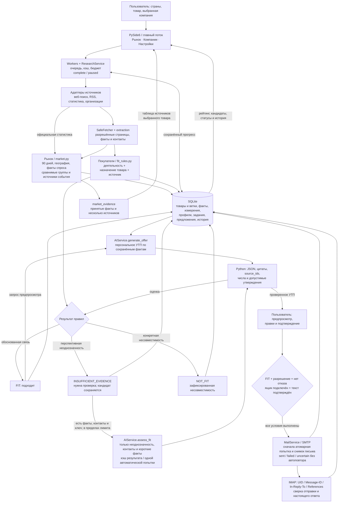
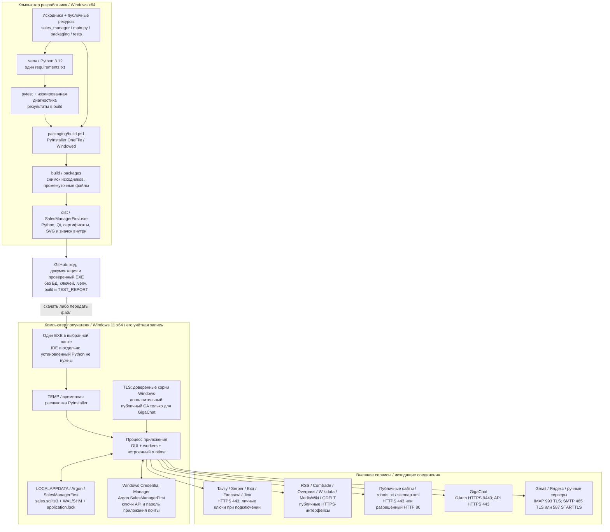
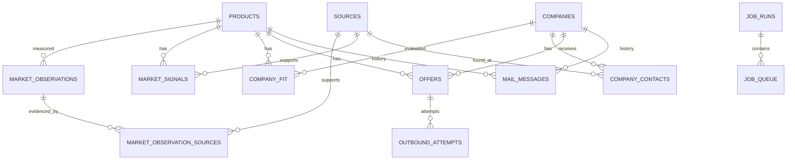
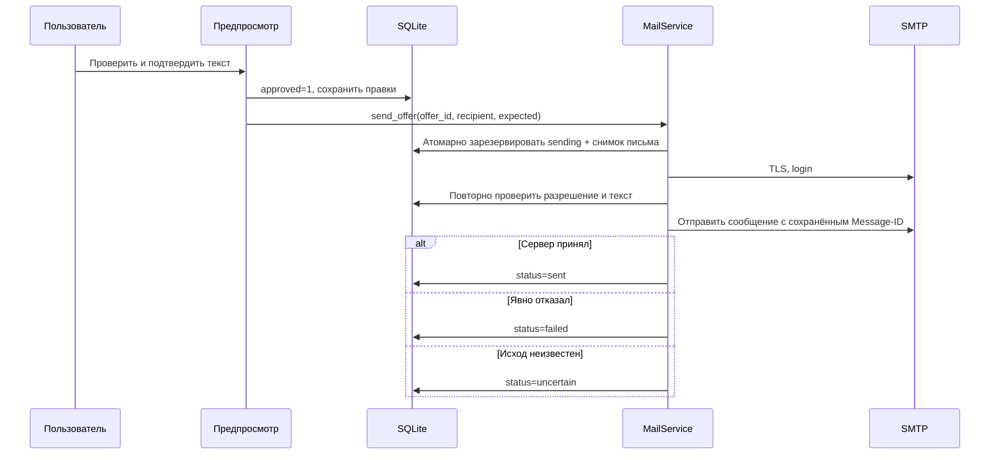

# SALES MANAGER FIRST — подробное техническое задание и устройство реализации
Уточнения 1.3.8: подключение поисковых API с ключами явно недоступно по правилу отсутствия списаний; галочка не предлагается как способ включения. Для проверки УТП нормализуются известные словоформы, дата не смешивается с длительностью, а подпись добавляется программно из настроек (offer-v3). SQLite закрывается в потоке каждой завершившейся задачи, включая ошибки. Косметическое изменение страницы сохраняет AI FIT только при наличии прежней цитаты на том же URL и подтверждении актуальных фактов; новые отказы приоритетны. Пропавший email требует явного выбора нового адресата. Повторные буквы в новом названии товара не записывают одинаковое состояние. MIME и IMAP-даты не зависят от регистра и локали. Сборка, диагностика, кэши и тестовые базы теперь находятся внутри build проекта.

Актуализация: 19 ноября 2026. Текущая версия приложения: 1.4.3. Целевая среда: Windows 11 x64, Python 3.12, PySide6, SQLite. Основной способ выпуска: один EXE через PyInstaller. Уточнения 1.3.8 выше и исторические разделы ниже действуют только в части, не противоречащей актуальным контрактам следующего раздела.

Изменения 1.3.7 уточняют нижеследующие контракты: все автоматические проверки, включая перенесённый набор качества и runner стабильности, находятся в `tests/` с одним корневым `pytest.ini`. После генерации УТП короткая транзакция сравнивает исходный снимок черновика, попытки отправки и поколение подключения; устаревший результат не перезаписывает изменения. Масса, объём и контейнеры не преобразуются в штуки и остаются публичными сигналами без несопоставимых чисел. Правила `activity-fit-v3` требуют связи сервисного центра с электроникой и отвергают отрицания ассортимента; AI-кэш — `fit-v5`. Однократная локальная перепроверка распознаваемых старых автоматических FIT сохраняет ручные решения, подтверждение OSM, черновики и переписку, записывая прежнюю причину в аудит. Схема SQLite остаётся 4. Исходный PNG значка сохраняется в проекте, в EXE включается только ICO.

README.md — короткая инструкция пользователя: запуск, настройки и обычные действия. Этот документ — инженерное описание: компоненты, потоки данных, алгоритмы решений, состояния, схема хранения, инфраструктура и проверяемые контракты.

## Актуальные контракты 1.4.3
Дополнения выпуска 1.4.3: текущая схема SQLite — 6; миграция с версии 5 добавляет сведения о филиалах и ключи идентичности, сохраняя контакты, разрешения, УТП и переписку. Кандидаты `INSUFFICIENT_EVIDENCE` видны без контакта, но не получают FIT и не могут быть адресатами рассылки. Филиал оценивается по его собственной странице и описанию, а не по деятельности головной компании. Ручной контакт сохраняет указанную пользователем публичную ссылку как источник, но не подтверждает достоверность ссылки или разрешение на письмо. Сбой обработки компании изолируется от остальных заданий; ошибки SQLite остаются фатальными, а сбой планирования поиска оставляет очередь доступной для продолжения. Плашка поиска предлагает отмену после текущего сетевого действия с сохранением очереди. Без ключа GigaChat можно открыть и заполнить пустой черновик; подтверждённый FIT, разрешение, проверка запрета и подтверждение пользователя обязательны для отправки.

Этот раздел заменяет противоречащие ему описания прежних версий ниже. Старые разделы сохранены как история инженерных решений. Результаты последней проверки находятся в начале `TEST_REPORT.md`.

- Три вкладки: «Рынок», «Компании», «Настройки». Тема тёмная, нижняя строка состояния скрыта; уведомления и плашка занятости находятся в рабочем окне.
- Поиск самостоятельно выполняет конечный сохранённый план пакетами. Пользовательских кнопок «Пауза» и «Продолжить» нет. Новое прерывание имеет статус `interrupted`, штатный итог — `complete`; `paused` читается для совместимости старой базы.
- После сбоя `running` переводится в `interrupted`, задачи возвращаются в `pending`. Автовосстановление при запуске использует точный `run_id`; завершение нового ручного поиска не переключает пользователя на старую ветку.
- Размер пакета автоматически расширяется; месячная квота внешнего API контролируется отдельно. Ошибка одной страницы изолируется, временный отказ источника не уничтожает возможность повторить его при восстановлении незавершённого запуска.
- Одинаковый поиск категории GDELT не размножается по странам. География подтверждается текстом, а не присваивается статье по стране задания.
- Товары связываются по нормализованной идентичности с сохранением отдельных модельных веток. Неизвестная новая страна не создаёт дубль однозначно найденной прежней компании; неоднозначные организации автоматически не объединяются.
- Временный сбой сайта сохраняет прежнего кандидата и его связи с доказательствами. Счётчик компаний и основная таблица используют единые критерии видимости.
- Схема SQLite — **5**, старые данные и переписка сохраняются миграциями; база не пересоздаётся. Ручные решения не перезаписываются AI.
- Поддерживается бесплатный Tavily Researcher при подтверждённых условиях доступа и отключённом Pay-as-you-go. Безлимитный ключ ограничивается остатком аккаунта. Остальные ключевые API остаются отключёнными без доказательства отсутствия списаний; галочка доступ не разрешает.
- Короткий prompt GigaChat не отменяет проверки полных сохранённых источников. Цитаты, числа, источники и допустимость утверждений проверяются программно.
- Отправленное письмо и письмо с выполняемой либо неопределённой отправкой защищены от редактирования и регенерации. Отправленный снимок хранится отдельно. Повтор после однозначной ошибки фиксирует время новой попытки; неопределённый исход не допускает автоматического повтора.
- Новые секреты хранятся в Windows Credential Manager с LOCAL_MACHINE persistence. Неудача обновления старой записи не блокирует запуск, не удаляет ключ и отображается предупреждением в настройках. Открытого экспорта секретов нет.
- Ожидание Crawl-delay и блокировки origin реагируют на отмену. При отсутствии HTTP charset учитывается HTML meta charset; ограничения robots.txt и TLS сохраняются.
- Все тестовые базы и сборочные материалы находятся внутри `build/`. Рабочая база и личные подключения в проверках не используются. QtTest исключён из основного EXE.

## Историческое описание 1.3.8 и ранее

## 0. Назначение и приоритет документа

Этот файл описывает требования продукта и фактическую механику существующего кода. Он заменяет прежнюю редакцию этого же ТЗ: Gmail теперь первый вариант почты, поиск расширен, PyInstaller выбран основным сборщиком, зависимости находятся в одном `requirements.txt`.

- **Требование** — согласованное поведение, которое нужно сохранять.
- **Реализация** — механизм, существующий в исходниках этой версии.
- **Ограничение** — граница возможностей или проверки, которую нельзя выдавать за выполненную функцию либо достоверный факт.

Новые явные указания владельца проекта имеют приоритет. Документ не разрешает добавлять незаказанные функции, платные поисковые подключения, автоматические рассылки, поиск поставщиков и Excel-экспорт. Не переписывать работающий проект заново. Изменение программного контракта сопровождается обновлением соответствующего раздела и необходимых проверок.

Описание API отражает запросы приложения, а не обещание неизменности внешнего сервиса. Фактические проверки находятся в `TEST_REPORT.md`. Наличие адаптера и тест на имитации не означают подключение к реальному аккаунту.

## 1. Конечный продукт и пользовательский сценарий

Пользователь получает `dist/SalesManagerFirst.exe` и открывает двойным щелчком. Python, PyCharm, терминал и локальный веб-сервер не нужны. Сеть нужна поиску, GigaChat и почте; сохранённые сведения доступны локально.

1. Ввести свои подключения в «Настройках».
2. Найти актуальные товары во вкладке «Рынок» либо ввести собственный товар во вкладке «Компании».
3. Выбрать товар, открыть его отдельную ветку и запустить поиск покупателей во вкладке «Компании».
4. Проверить компанию, контакты, источники и гипотезу применимости.
5. Зафиксировать основание для контакта и его подтверждение.
6. Создать УТП, прочитать и при необходимости изменить его.
7. Подтвердить отправку конкретному получателю.
8. Проверять ответы и просматривать точную историю ветки.

Название отправителя по умолчанию «Аргон»; название и подпись редактируются. Адрес From определяется подключённым ящиком. Нельзя придумывать реквизиты, цены, остатки, скидки, гарантии, сроки и возможность поставки.

Один EXE — формат передачи приложения. Пользовательские сведения не встраиваются в него; замена EXE сохраняет локальную историю. Другой Windows-пользователь получает собственные базу и секреты.

## 2. Обязательные инварианты

1. Обычный поиск, чтение страниц и обработка почты не вызывают GigaChat.
2. Нет демонстрационных компаний, выдуманных продаж, фиктивного баланса и имитации отправки в рабочем режиме.
3. Публикация, косвенный сигнал, измерение и коммерческая гипотеза различаются.
4. Отсутствие товара на сайте не доказывает отсутствие товара у компании.
5. Доступными источниками можно пользоваться без поисковых ключей.
6. Дополнительные ключи не отменяют ограничений источника и правил бесплатного доступа.
7. Очередь и найденное сохраняются при паузе и сбое.
8. Предложения и переписка разных товаров не смешиваются.
9. Предпросмотр, подтверждение и зафиксированное разрешение обязательны; отказ получателя имеет приоритет.
10. Неизвестный исход SMTP не вызывает автоматическую повторную отправку.
11. Секреты не попадают в SQLite, Git, EXE, ошибки и открытые логи.
12. UX/UI: «КОРОТКО И ПО СУТИ», три вкладки, ясное состояние и следующий шаг при ошибке.
13. CAPTCHA, авторизация, robots.txt и ограничения доступа не обходятся.
14. База пользователя не пересоздаётся ради новой схемы; используются миграции.
15. Служба Windows, автозапуск и плановое задание для работы после закрытия не создаются.

## 3. Архитектурная и инфраструктурная схемы

Схемы записаны в Mermaid и находятся непосредственно в этом Markdown-документе. Первая описывает взаимодействие программных компонентов и бизнес-процесс; вторая — размещение, сборку, данные пользователя и внешние соединения.

### 3.1. Архитектурная схема: компоненты и бизнес-логика



Поисковые сервисы находят ссылки и исходные сведения. Python выбирает маршруты, извлекает факты и контакты, устраняет повторы и управляет состоянием; SQLite хранит результат. GigaChat оценивает неоднозначную применимость и пишет УТП по коротким фактам. Почта отправляет после решения пользователя и сопоставляет ответы без модели.

У модели нет набора инструментов для произвольных действий: она не получает право запускать поиск, читать локальные файлы, исполнять Python и отправлять письма. Ответ модели — проверяемые JSON-данные, а не команда к исполнению.

**Переходы:** очевидное соответствие сохраняется Python без модели; неоднозначный кандидат не исчезает при отсутствии ключа. Отправка начинается только через подтверждение и проверку условий. Неясный исход отправки идёт в сверку, а не в повторный send. Сеть работает в workers, обновление виджетов — через сигналы главного потока.

### 3.2. Инфраструктурная схема: сборка, размещение и соединения



**Границы размещения:** `build` — результаты проверок разработчика; сборочный staging — другой каталог в LocalAppData. Рабочая база получателя и его Credential Manager создаются отдельно от EXE и не уходят в GitHub. Внешние сервисы получают только данные соответствующего запроса; входящий локальный HTTP-сервер, Docker, удалённая БД и отдельная Windows-служба не требуются.

**Обновление:** новая сборка заменяет файл EXE, а миграции обновляют существующую пользовательскую SQLite без потери записей. Ресурсы распаковываются во временный каталог; клиентская история туда не переносится. Диагностика использует отдельные базы и пространство секретов, а её окно запускается без показа на рабочем столе.

## 4. Карта модулей

| Файл | Ответственность |
|---|---|
| `main.py` | Специальный `--smoke-test <каталог>` либо обычный GUI |
| `sales_manager/__init__.py` | Версия приложения |
| `ui/app.py` | Главное окно, настройки, таблицы, фоновые действия, единичный запуск |
| `ui/dialogs.py` | Страны, источники, компания, УТП и история |
| `ui/workers.py` | QRunnable и сигналы результата, прогресса, ошибки, завершения |
| `research/providers.py` | Адаптеры, формат SearchResult, ошибки источников |
| `research/service.py` | Планирование, очередь, кэш, исследование рынка и компаний |
| `research/fit_rules.py` | Деятельность компании, источники и правила применимости товара |
| `research/market.py` | Типизированные измерения, события и рейтинг сопоставимых показателей |
| `research/normalization.py` | Товары, алиасы, страны, покупатели, OSM-фильтры |
| `research/extraction.py` | HTML, контакты, RSS/Atom, sitemap, ссылки-кандидаты |
| `research/safe_http.py` | Публичные адреса, DNS, TLS, robots, ограничения чтения |
| `research/quota.py` | Реальный остаток Tavily / Firecrawl из аккаунтных API |
| `ai/service.py` | GigaChat, валидация, кэш и учёт токенов |
| `ai/certs` | Публичный корневой сертификат GigaChat и его описание |
| `mail/service.py` | TLS IMAP/SMTP, попытки отправки, сверка и ответы |
| `storage/store.py` | Потоковые соединения SQLite и операции хранения |
| `storage/migrations.py` | Версионная схема и атомарные миграции |
| `storage/secrets.py` | Windows Credential Manager без открытого fallback |
| `core/smoke.py` | Изолированная диагностика окна, ресурсов, TLS и БД |
| `assets` | Изображение робота и многоразмерный ICO |
| `packaging` | Сборка и диагностические сценарии |
| `tests` | Контролируемые проверки поведения |

`core` не содержит самостоятельного коммерческого движка. Предварительный отбор находится в `ResearchService._fit`, смысловая оценка — в `AIService.assess_fit`. Название каталога не заменяет карту фактических вызовов.

## 5. Файлы, зависимости и build

| Путь | Назначение | GitHub |
|---|---|---|
| `sales_manager`, `main.py` | Исходники и публичные ресурсы | Да |
| `dist` | Готовый проверенный EXE | Да |
| `packaging`, `tests` | Инструменты и проверки | Да |
| `requirements.txt` | Единственный список пакетов с точными версиями | Да |
| README, это ТЗ, pytest.ini, .gitignore | Инструкции и настройки проекта | Да |
| TEST_REPORT.md | Локальный отчёт проверок | Нет; исключён через .gitignore |
| `.venv` | Действующее окружение Python 3.12 | Нет |
| `.venv314-backup`, если осталась | Старое окружение Python 3.14; можно удалить вручную | Нет |
| `.idea`, `.pytest_cache`, `__pycache__` | Настройки IDE и кэши | Нет |
| `build` | Снимки, JSON-отчёты, диагностические базы | Нет |
| `nuitka-crash-report.xml`, если остался | Старый отчёт сбоя; можно удалить вручную | Нет |

### 5.1. Как используется build

Корневая `build` обслуживает проверки проекта. `build/smoke-exe` содержит снимки вкладок, изолированную SQLite и result.json; `build/live-sources.json` — результаты сетевых проб; `build/ui-upgrade` — снимки компоновки. Эти базы не являются клиентской базой пользователя.

Для запуска приложения папка не нужна. Скрипты создают нужные каталоги повторно; старые результаты можно удалить после завершения использующей их проверки.

Сам сборщик работает в `build/packages/<UTC-время>` внутри проекта. Там находятся снимок исходников, промежуточные файлы и результат сборщика; в `dist` копируется EXE. Автоматической очистки старых сборочных снимков сейчас нет.

### 5.2. Почему один requirements.txt

Один файл обслуживает весь проект разработчика: приложение, тесты, PyInstaller и дополнительный Nuitka. Сохранены прямые и транзитивные зависимости проверенного окружения. Обычный пользователь EXE ничего из этого не устанавливает.

На новом компьютере создаётся `.venv` с Python 3.12 x64, затем выполняется `python -m pip install -r requirements.txt` через этот интерпретатор. Для PyCharm сначала определяется настроенный SDK; нельзя случайно использовать старый Python 3.14.

Закрепление версий не включает хеши пакетов, собственное зеркало дистрибутивов или компилятор C. Это воспроизведение версий Python-окружения, а не обещание побитово одинакового EXE и вечной доступности пакетов.

## 6. Жизненный цикл запуска

1. `main.py` без диагностического аргумента вызывает `ui.app.run()`.
2. Создаётся QApplication, назначаются палитра, шрифт и значок.
3. Создаётся каталог данных и захватывается QLockFile `application.lock` до открытия рабочей базы. Второй экземпляр показывает сообщение, что приложение уже открыто.
4. Создаются Store, Secrets, ResearchService, AIService и MailService; читаются настройки и ветки.
5. Store применяет миграции и восстанавливает незавершённые состояния.
6. Показываются сохранённые данные независимо от наличия ключей и сети.
7. При наличии подключённого ящика запускается отложенная проверка почты; далее работает таймер, пока окно открыто.
8. При закрытии отменяется исследование, останавливаются таймеры, завершаются активные операции, закрывается БД и снимается блокировка экземпляра.

Служба и автозапуск не создаются. Диагностический режим работает с отдельной БД и сам заканчивает процесс; это отдельный сценарий, а не обычный пользовательский запуск.

## 7. Товар и отдельная ветка

Товар — запись products: name для отображения, normalized как уникальный нормализованный идентификатор, id для связей. Повторное добавление normalized возвращает существующий товар.

Ветка не является процессом или отдельной базой. Она определяется product_id в company_fit, offers, mail_messages и заданиях. Открытые ветки хранятся в `product.branches`, выбранная — в `product.active`. Открытие ветки переключает вкладку «Компании».

Компании, контакты и источники общие; пригодность, УТП и переписка выбираются по товару и компании. Разрешение и отказ не являются свойством товара: отказ по email действует глобально.

На пару товар–компания хранится одно редактируемое предложение. Серии писем и кампании не реализованы. Таблица product_variants есть в схеме, но не наполняется полноценной историей товарных модификаций.

## 8. Нормализация, словарь и география

Код: `research/normalization.py`. `clean_text` применяет Unicode NFKC, casefold, замену «ё» на «е» и свёртку пробелов. `normalize_product` очищает внешнюю пунктуацию, проверяет непустое имя до 160 символов, неподдерживаемые категории, затем алиасы и словарь. Для неизвестного товара остаётся нормализованная введённая строка.

iPhone / Samsung Galaxy / Xiaomi сводятся к «смартфон», MacBook — к «ноутбук», iPad — к «планшет». Это обеспечивает разные виды товаров в рейтинге. Нормализация намеренно объединяет модели; отдельной онтологии SKU, GTIN и характеристик нет.

`matches_product` сопоставляет слова регулярными выражениями: у коротких обязательны границы, у длинных допускается продолжение основы. Это эвристика, а не морфологический анализатор. «Стол» не должен совпадать со «столицей».

В CATEGORIES 27 категорий обычных товаров: электроника, техника, материалы, оборудование, упаковка, питание и другие. Словарь задаёт направления запросов и распознаваемые названия. Словарная запись не является доказательством спроса и не создаёт рейтинг сама по себе.

UNSAFE отклоняет ряд категорий: оружие, боеприпасы, наркотики, взрывчатые вещества, табачные и алкогольные товары, пестициды, лекарства. Это ограничение текущего продуктового словаря, а не универсальная правовая классификация.

`buyer_segments` возвращает несколько групп покупателей. Электроника: магазин, дистрибьютор, сервисный центр; питание: ресторан, кафе, гостиница, продуктовый магазин; упаковка: производитель, интернет-магазин, склад. Для неизвестного товара используются общие шаблоны.

`osm_filters` сопоставляет товары с тегами OSM: например, кофе с amenity=restaurant, amenity=cafe и tourism=hotel. Для части товаров соответствия нет; тогда адаптер возвращает пустой список, а не выдумывает категорию.

Страны: Россия, Беларусь, Казахстан, Армения, Азербайджан, Кыргызстан, Молдова, Таджикистан, Туркменистан, Узбекистан. В коде заданы ISO-коды и QID. Это конфигурация географии, а не обещание полного покрытия организаций.

## 9. Векторы, embeddings и смысловая близость

### 9.1. Что есть в реализации

В проекте **нет собственного векторного пространства поиска**. Отсутствуют вызовы embeddings API, матрицы представлений документов, векторная база, FAISS/Qdrant/Chroma, поиск ближайших соседей, косинусная близость, обучение своей модели и RAG по векторному индексу.

SQLite хранит строки, JSON, идентификаторы и отдельные показатели. Нет таблицы embeddings, размерности d, индекса HNSW/IVF и этапа преобразования текста в числовое смысловое представление. Нельзя описывать приложение как векторный поиск только из-за названия внешнего сервиса.

| Объект | Представление | Операции |
|---|---|---|
| Товар | Строка, normalized, id | Алиасы, regex, SQL |
| Факт | Текст, URL, дата, SHA-256 | Подтверждение и короткая карточка |
| Компания | Запись SQLite и контакты | Правила применимости и дедупликация |
| Пригодность | enum, reason, source_ids, nullable a/b/c | Решение, а не расстояние |
| Сигнал рынка | Число 1 или 2 и текст | Суммирование свидетельств |
| Кэш | SHA-256 сериализованного входа | Точное совпадение |
| GigaChat | Внешний запрос с текстом/JSON | Смысловая оценка и УТП |
| Exa | Внешний запрос веб-поиска | Готовые ссылки и извлечения |

### 9.2. Почему хеш не является embedding

SHA-256 возвращает 256-битный отпечаток. В проекте он служит ключом точного содержимого, кэша или попытки отправки. Близость двух хешей не означает похожесть товаров; расстояния между ними не вычисляются.

### 9.3. Что означают A/B/C

В предметной модели A — соответствие деятельности, B — сигнал потребности, C — надёжность контактов. Фактически `_company` пишет a=1 при FIT, иначе NULL; b=NULL; c=1 при наличии контактов, иначе NULL. Шкалы объёма закупки, вероятности сделки или реальной верификации контакта нет.

Тройку (a,b,c) математически можно представить как признаки, но код не задаёт веса, метрику, нормализацию и обучение. NULL — неизвестность, а не нулевой шанс продажи. Поля нельзя выдавать за «вероятность сделки 95%».

### 9.4. Где проходит граница внешнего ИИ

GigaChat выполняет смысловую обработку на стороне провайдера. Приложение не задаёт и не хранит размер скрытых представлений, число слоёв, токенизатор, веса и геометрию внутренних признаков. Приписывать конкретную размерность нашему проекту нельзя.

Exa может иметь собственные внутренние механизмы поиска. Через используемый контракт приложение получает результаты, а не embeddings и описание индекса.

Если позже появится отдельное согласованное требование на embeddings, понадобится конкретная модель, её размерность и версия, метрика, миграция хранения, правила обновления и тесты качества. Эта редакция такого расширения не заказывает.

## 10. Контракт SearchProvider и SearchResult

Каждый адаптер имеет `search(query, country, limit=10)`. Он возвращает list[SearchResult] либо типизированную ошибку.

```python
SearchResult(
    url: str,
    title: str = '',
    snippet: str = '',
    country: str = '',
    published_at: str = '',
    metadata: dict = {},
)
```

В реальном dataclass metadata создаётся через default_factory, то есть не разделяется между объектами. Метод to_dict сериализует результат для очереди. URL и фрагмент ещё не доказывают официальность, текущий спрос или пригодность компании.

Metadata может содержать provider, source_url, entity_id, OSM-теги, website, emails, phones, segment_verified, discovery_urls, feed_url, discovered_from и discovery_source_id. Наборы полей разных адаптеров различаются.

country может обозначать только страну запроса. Для произвольного веб-результата она сама не доказывает местоположение компании. Последующая проверка страны также имеет эвристические границы.

## 11. Адаптеры с ключами

| Адаптер | Endpoint | Авторизация | Параметры и выдача |
|---|---|---|---|
| Tavily | POST https://api.tavily.com/search | Bearer | basic; auto_parameters=False; include_answer=False; include_raw_content=False; include_images=False; include_usage=True; до 10 результатов |
| Serper | POST https://google.serper.dev/search | X-API-KEY | q, gl из страны, hl=ru, num до 10; массив organic |
| Exa | POST https://api.exa.ai/search | x-api-key | type=lite; numResults до 10; userLocation; текст до 5000 символов |
| Firecrawl | POST https://api.firecrawl.dev/v2/search | Bearer, если есть ключ | web; limit до 10; country/location; highlights=False; safe=True |
| Jina Search | GET https://s.jina.ai/ и кодированный запрос | Bearer | JSON; X-Respond-With=no-content; X-Retain-Images=none; ограниченный num |

Tavily не запрашивает AI-ответ и полный HTML. Jina Search требует ключ; другой продукт Jina Reader не считается поиском без ключа. Serper — самостоятельный сервис выдачи; приложение не обходит Google/Яндекс скрейпингом.

Ключ `<provider>_key` хранится в Credential Manager; переключатель `search.<provider>_enabled` — в SQLite. Использование ключа требует `search.free_confirmed`. Неподтверждённый ключ не передаётся сервису.

Firecrawl сохраняет возможность запроса без Authorization. Если подключённый подтверждённый ключ не используется, возможен keyless-доступ в пределах разрешений IP. 401/403 без ключа становятся MissingKeyError, а не успешной пустой выдачей. Программа не меняет тариф и не включает автопополнение.

## 12. Источники без ключей

### 12.1. OpenStreetMap / Overpass

Основной endpoint: https://maps.mail.ru/osm/tools/overpass/api/interpreter. Сервер VK Maps указан в перечне OpenStreetMap как доступный для любых проектов; старый overpass-api.de не выбран основным из-за условий и перегрузки.

Адаптер строит Overpass QL: ISO страны, административная область уровня 2, объединение nwr по подходящим тегам и наличие имени. Запрос ограничивает время 20 секундами, память 134217728 байтами и выдачу 30 результатами. Передача — POST, поле data.

Возвращаются устойчивая ссылка `openstreetmap.org/<type>/<id>`, имя, деятельность, website/contact:website и контакты из тегов. URL без схемы получает https. Подходящий тип организации обосновывает гипотезу использования товара, но не текущую закупку.

Не каждый товар имеет OSM-фильтр. Небольшой успешный запрос не подтверждает доступность полного поиска по стране; перегруженный сервер может отвечать 503 или тайм-аутом.

### 12.2. GDELT

GET https://api.gdeltproject.org/api/v2/doc/doc: ArtList, JSON, timespan=3months, DateDesc и ограниченная выдача. Синтаксически опасные символы выражения очищаются, длина запроса ограничивается.

Возвращаются новости, даты seendate и исходная страна, если есть. Число упоминаний не является объёмом продаж. Для компаний публикация становится источником ссылок-кандидатов, а не официальной компанией автоматически.

### 12.3. Wikidata

Первый запрос к https://www.wikidata.org/w/api.php ищет сущности со страной P17 и сайтом P856. Второй получает labels, descriptions и claims по QID. Учитываются недепрецированные утверждения; без нужной страны и сайта запись пропускается.

Возвращаются website из утверждения, label/description, QID и URL сущности. Структурированный источник не отменяет проверку страницы и контактов.

### 12.4. Wikipedia / MediaWiki

GET https://ru.wikipedia.org/w/api.php: generator=search, extracts, info и extlinks; maxlag=5, ограниченные извлечения и ссылки. Внешние ссылки являются кандидатами, а не подтверждением официальности.

Для компании используется фаза discovery. Статья энциклопедии не становится строкой покупателя. Правильный ответ без страниц отличается от некорректной структуры.

### 12.5. RSS / Atom

Пять стандартных адресов:

1. https://www.retail.ru/rss/news/
2. https://www.retail.ru/rss/articles/
3. https://www.cnews.ru/inc/rss/news_top.xml
4. https://www.vedomosti.ru/rss/rubric/business/retail
5. https://www.vedomosti.ru/rss/rubric/business/industry

Официальные перечни: https://www.retail.ru/rss/, https://www.cnews.ru/rss, https://www.vedomosti.ru/info/rss. effective_urls заменяет только точные прежние стандартные списки Банка России либо двух Retail.ru; пользовательские адреса сохраняются. Используются первые восемь разных URL с SafeFetcher, robots и ограничениями объёма. Наличие RSS не отменяет проверки разрешения конкретной статьи и её доступности без авторизации.

Парсер поддерживает rss, feed и RDF, в том числе пространства имён; извлекает item/entry, title, link, описание и дату. Описание очищается от HTML, RFC-дата преобразуется в ISO. На одну ленту — до 200 записей, заголовок 300 и фрагмент 5000 символов.

RSSProvider._load_items читает каждый адрес один раз за исследовательский проход, включая отказавшие адреса. Записи разных изданий чередуются, повторные URL удаляются. last_responded/last_attempted/last_errors различают частичный ответ лент и полный отказ. discover(country,limit=200) передаёт публикации движку; страна здесь только контекст запроса. Для покупателей прежний search фильтрует записи по товару/категории.

На рынке заголовок и описание служат предварительному отбору, а факты извлекаются также из разрешённого текста самой статьи. Это позволяет увидеть показатели, которых нет в RSS-анонсе. Корректная лента без релевантных материалов остаётся успешным пустым ответом.

### 12.6. Каталоги и публикации закупок

PublicPagesProvider создаётся отдельно для catalog/procurement. Они по умолчанию отключены и требуют разрешённых URL; читаются максимум первые три страницы.

Это доступ к публичным страницам, а не ко всем закупкам, платным каталогам, контактам 2ГИС или закрытым данным маркетплейсов. Внешние ссылки сначала исследуются как кандидаты; компания и применимость проверяются отдельно.

### 12.7. Официальный сайт и sitemap

Сайт читается ограниченным обходчиком. Если полезных ссылок мало, дополнительно проверяется /sitemap.xml. Поддерживается urlset; выбираются контакты, сведения о компании, каталоги и товары того же нормализованного домена. Рекурсивного sitemapindex нет.

Механизм работает и с ручным URL без поисковых ключей. Существование сайта само по себе не доказывает спрос.

### 12.8. UN Comtrade

Бесплатный preview API поддерживает явные HS-коды кофе, чая и смартфонов; выдаёт импорт USD/kg с годом, страной и URL. Адаптер, настройка и самостоятельная проверка сохранены, но автоматический поиск актуальных товаров больше не ставит ему задания для всех категорий. Импорт сохраняется дополнительным показателем и сам по себе не вводит товар в рейтинг текущего спроса. Ключ не требуется; неизвестный код не выдумывается.

## 13. Режимы и маршрутизация

### 13.1. Базовый режим

Без используемых ключей показывается «Режим поиска: базовый — без API-ключей». Для текущего рынка применимы RSS, GDELT, настроенные публикации закупок и доступный веб-маршрут, включая разрешённый Firecrawl без ключа. Overpass, Wikidata, MediaWiki и каталоги используются для организаций или справочных сведений; они не являются измерением текущего спроса. Comtrade сохранён как отдельный статистический адаптер.

Каталоги и закупки требуют настройки. Источники с retry_until в будущем временно недоступны движку. Специализированные источники не заменяют универсальную поисковую выдачу.

### 13.2. Расширенный режим

Он включается, когда среди созданных доступных адаптеров есть сервис с используемым ключом. Наличие текста в выключенном поле или отсутствие подтверждения бесплатного аккаунта этого не обеспечивает.

Порядок веб-маршрута: Tavily → Serper → Exa → Firecrawl → Jina. Следующий используется при пустом результате или ошибке предыдущего; после непустого результата запрос остальным сразу не рассылается. Специализированные источники имеют собственные задания по назначению.

### 13.3. Нет источников

`available_sources(operation)` проверяет конфигурацию, применимость и сохранённый cooldown. Это не синхронный сетевой ping: доступность неизвестного источника устанавливается при реальном запросе или проверке в фоне.

При пустом списке показывается: «Нет доступных источников поиска. Включите хотя бы один бесплатный источник или добавьте API-ключ поискового сервиса в настройках». Пользователь открывает уже существующую вкладку «Настройки»; отдельной дублирующей кнопки в главном окне нет. Пустой job_run не создаётся, выдуманных результатов нет.

Если отдельный источник отказал после старта, найденное и его отложенные задания сохраняются. Ответы остальных источников обрабатываются до конца; невыполненные задачи дают paused с reason=sources_unavailable и конкретной причиной в `job_runs.message`. Исключение — частично работающие RSS: доступные ленты обрабатываются один раз с сообщением об ограниченном охвате; полностью недоступный RSS допускается пропустить после двух сбоев только при реальном ответе другого источника в этой сохранённой работе. Единственный неработающий RSS остаётся paused. Ручной URL исследуется независимо от поисковых подключений.

## 14. Ошибки источников и cooldown

| Случай | Статус | Действие |
|---|---|---|
| Нет ключа | MissingKeyError / «Нет ключа» | Подсказка настроек |
| 401, распознанный отказ ключа | InvalidKeyError / «Неверный ключ» | Отложить источник; заменить ключ |
| 402, 432, 433 либо сообщение об исчерпании кредитов | QuotaError / «Квота закончилась» | Другой источник; сохранить очередь |
| 429 без признака кредитной квоты | RateLimitError / «Временное ограничение» | Retry-After и другой источник |
| 403 без специальной причины | ProviderError / «Недоступен» | Отказ доступа; без обхода |
| 5xx, транспорт, TLS | ProviderError / «Недоступен» | Отложить и попробовать доступное |
| Правильная пустая выдача | «Работает», [] | Штатный результат |
| Неправильный JSON / структура | InvalidResponseError / «Недоступен» | Не сохранять как достоверный результат |

`check_response` анализирует HTTP-код, тело и заголовки локально. Целиком тело ошибки не показывается: оно может отражать запрос или секрет. maxlag/ratelimited MediaWiki являются временными. Firecrawl без ключа имеет отдельную обработку 401/403.

Retry-After разбирается как секунды или HTTP-дата, минимум 1 секунда, по умолчанию 60. Общая ошибка откладывает источник на 120 секунд, неверный ключ и квота — на 86400. Последнее — локальная задержка текущей реализации, а не точная дата восстановления месячного тарифа.

`search.<name>_status` содержит status, message, retry_until, quota, checked_at и key_hash. key_hash — SHA-256 для обнаружения замены ключа, не сам ключ. Смена отпечатка исключает выдачу прежнего состояния и остатка за состояние нового ключа.

`test_provider(name)` берёт исследовательскую блокировку, пропускает кэш, делает запрос именно этому сервису и освобождает режим принудительного обновления в finally. Явная проверка повторно проверяет исправленное подключение; автоматические задачи соблюдают cooldown. В процессе исследования нельзя параллельно проверять тот же движок.

Один отказ не отменяет обработку ответов остальных источников. Сохранённые отложенные задания, отмена пользователя и лимит дают paused; частично доступный RSS и допустимый пропуск RSS описаны выше. Транспортная ошибка/5xx или короткий Retry-After допускают не более одного повтора; неверный ключ, квота и 403 автоматически не повторяются. Большой Retry-After переносится на следующий запуск. При продолжении веб-задачи маршрут пересчитывается с начала, чтобы восстановленный или заменённый ключ раннего сервиса снова участвовал; выполненные задачи не повторяются.

## 15. Запросы, кредиты и достоверный остаток

`usage_log` учитывает реальные JSON-попытки до обращения, включая неудачные. Попадание в кэш нового HTTP-запроса не создаёт. Публичные документы имеют отдельную операцию учёта. Это действия приложения, а не всех пользователей аккаунта.

Exa costDollars.total, если сообщён, записывается в credits. Поле разных провайдеров нельзя складывать в общий баланс рублей или условных кредитов. Нулевой credits не доказывает бесплатность.

После успешной проверки с ключом:

- Tavily: GET https://api.tavily.com/usage с Bearer; остаток `max(0, min(account.plan_limit - account.plan_usage, key.limit - key.usage))`. PAYG-кредиты не прибавляются.
- Firecrawl: GET https://api.firecrawl.dev/v2/team/credit-usage; data.remainingCredits принимается только при success=True.

Недостающие поля, отрицательное значение, строка, bool, NaN и бесконечность дают неизвестный остаток. Ошибка аккаунтного endpoint не превращает успешный поиск в неверный ключ. Остаток — снимок ответа, а не предсказание; новый обычный поиск сбрасывает устаревшее quota в статусе.

Бесплатный режим требует аккаунтов с бесплатными лимитами и отключёнными платными запросами/автопополнением. Программа не управляет оплатой всех внешних кабинетов. Галочка пользователя и локальный счётчик не являются техническим доказательством отсутствия биллинга.

## 16. Численные ограничения и отмена

| Параметр | Реализация |
|---|---|
| Запросов исследования | search.request_limit=100; код ограничивает диапазон 1–2000 |
| Страниц компании | search.page_limit=8; код допускает 1–20 |
| Ответ JSON | До 6 000 000 байт |
| JSON HTTP | timeout 30 с, connect 10 с, без редиректов, trust_env=False |
| SafeFetcher | timeout=15 с, max_bytes=2 000 000, max_redirects=4 |
| robots.txt | До 256 000 байт |
| Интервал Firecrawl | 6,1 с между запросами к хосту |
| Overpass VK Maps | 2 с |
| GDELT | 5,1 с |
| Wikidata | 1 с |
| Другие API | 0,3 с |
| Сайт | Не менее 0,35 с или больший Crawl-delay |
| Crawl-delay более 60 с | Обход прекращается |
| GigaChat | HTTP timeout=45 с; max_tokens=1200 |
| IMAP / SMTP | timeout=30 с |

`_requests` считает логические обращения движка. Один fetch может дополнительно читать robots, пробовать несколько IP и проходить редиректы; это не точный лимит TCP-соединений или всех пакетов.

Отмена проверяется до новых операций и во время пауз частоты. Уже идущий сетевой вызов может завершиться только по ответу или timeout. «Пауза» не обещает мгновенно оборвать сокет; GUI остаётся отзывчивым.

## 17. SafeFetcher: границы сетевого доступа

Загрузка не использует браузер и не выполняет JavaScript. Разрешены HTTP/HTTPS без credentials в URL, порты 80/443, корректный host и ограниченная длина адреса. localhost, внутренние суффиксы и приватные адреса запрещены.

DNS проверяется перед подключением; все адреса должны быть публичными. Смешанный публичный/приватный ответ отклоняется. Учитываются IPv4, IPv6 и IPv4-mapped IPv6. Соединение закрепляется за проверенным IP, а Host и TLS server_hostname сохраняют исходное имя. Это защита от смены DNS между проверкой и соединением.

Каждый редирект проверяется заново. Превышение числа переходов, размера или времени прекращает загрузку. TLS-цепочка и hostname проверяются. Основной fetch принимает HTML, plain text и XHTML; fetch_document дополнительно XML/RSS.

robots кэшируется по origin. 401, 403, 429 и 5xx при robots запрещают автоматическое чтение; запрет пути не обходится. Соблюдается Crawl-delay. Это ограниченный обходчик, а не гарантия поддержки всех вариантов сайта и всех расширений robots.

## 18. Извлечение фактов и контактов

`parse_page` использует BeautifulSoup/html.parser. Имя берётся из ограниченного JSON-LD Organization/LocalBusiness/Corporation/Store, затем og:site_name, title или домена. Никакой JavaScript не исполняется.

mailto и tel обрабатываются отдельно. script/style/noscript/iframe/svg удаляются; текст сворачивается и ограничивается 100000 символами. Полный HTML в GigaChat не уходит.

Email извлекается regex, приводится к нижнему регистру и очищается от пунктуации; похожие на графические файлы окончания исключаются. Телефон сводится к 10–15 цифрам; для России начальная 8 в 11-значном номере становится 7. Это проверка формы, а не существования и принадлежности контакта.

ИНН для России ищется по метке и длине 10/12 цифр. Контрольная сумма и реестр не проверяются. Совпадение regex нельзя выдавать за официальную верификацию юрлица.

Внутренние ссылки ранжируются по словам контактов, компании, каталога, услуг, проектов. Учитывается тот же нормализованный домен и до 40 кандидатов. Sitemap даёт до 30 полезных ссылок. Это эвристический выбор страниц, а не чтение всего сайта.

Внешние ссылки статьи ограничены, известные агрегаторы и социальные сети отсеиваются. Затем каждый кандидат проверяется отдельно. Список агрегаторов конечен: отсутствие домена в списке не доказывает официальность.

DTD и ENTITY в XML запрещены. sitemapindex не обходится рекурсивно. Правильная пустая лента отличается от повреждённого ответа.

## 19. Измеренные показатели и рейтинг

### 19.1. Планирование и первичный отбор

research_market создаёт одно широкое RSS-задание на страну, задания по настроенным публикациям закупок и ограниченные запросы категорий к GDELT/веб-маршруту. Энциклопедии, каталоги организаций и Comtrade больше не перебираются как измерители спроса. Фаза market_page имеет приоритет, поэтому найденные статьи обрабатываются до следующих поисковых запросов.

RSS обнаруживает ссылки и чередует издания; заголовок/анонс проверяются на товарные категории и содержательную связь со спросом. Рассматривается до 60 публикаций RSS на страну за проход в пределах общего бюджета запросов. Недоступная статья не вызывает платный поиск только ради её чтения; уже имеющийся содержательный анонс может использоваться как источник факта после тех же проверок.

### 19.2. Извлечение измерений

_market_evidence сохраняет market_observations: товар, metric, value, unit, period, country, source_id, published_at, excerpt, measured, event_key, created_at. Продажи, закупки, заказы, поисковые запросы, упоминания и импорт имеют разные типы и единицы.

Для RSS и веб-публикаций читается разрешённая страница; отдельный article_text выделяет основной текст статьи. Меню, теги, футер и рекомендации не должны создавать товары. В анализ передаётся текст статьи, а не весь HTML; обычное извлечение выполняется без GigaChat.

Python связывает число с явно названным товаром внутри соответствующей части предложения, проверяет тип показателя, единицу, период и страну. Часть с другим неизвестным товаром не наследует товар предыдущей части: проценты парфюмерии не становятся процентами одежды. Рост цен не является ростом продаж; снижение и прогнозы не записываются как положительные текущие показатели. Структурированные данные также проверяются по сохранённой выдержке. ISO-период YYYY-MM не считается отрицательным числом и его месяц не становится количеством проданных единиц. Слово «распродажа» не распознаётся как измеренные продажи; дробная промодата 11.11 не становится количеством штук. Отдельная гендерная группа в процентном показателе остаётся в его подписи. Фраза сравнения «годом ранее» не наследует текущий отчётный период. Общий бюджет комплекта оборудования не присваивается одному из перечисленных товаров: такая закупка остаётся публичным фактом потребности без выдуманного объёма именно серверов или другого элемента комплекта.

### 19.3. Условия допуска в текущий рынок

ACTUAL_DAYS=90 — одно окно актуальности публикации и отчётного интервала. Публикация с известной датой должна находиться в этом окне и не относиться к будущему; неразбираемая непустая дата отклоняется. Отчётный период, если задан, должен пересекаться с окном и не начинаться в будущем. Свежая перепечатка прошлогоднего измерения сама по себе не делает его текущим. Если период отсутствует, нужна настоящая дата публикации; fetched_at её не заменяет.

Страна подтверждается сохранённым фрагментом либо текстом источника. Страна поискового запроса не становится фактом географии; упомянутые в локальном факте Индия, Китай, США и Евросоюз не наследуют Россию из заголовка. Подходящий косвенный сигнал должен сообщать фактическую покупку/закупку/заказ или рост покупательского интереса. Рост просмотров карточек и сообщённое увеличение интереса остаются косвенными фактами, без выдуманного числа продаж. Рост «в несколько раз» без явно названного измерителя может сохраняться косвенным фактом при контексте спроса в соседнем фрагменте; подпись сохраняет фактический текст и число, не переименовывает его в продажи. Реклама, вывод нового продукта, вопрос-календарь, наличие в ассортименте и рост цен сами по себе не проходят. Старые слабые и типизированные строки не удаляются: при чтении повторно разбираются их число, товар, тип, единица, период и страна. Разбор сохранённых источников кэшируется на время одной выборки.

DEMAND_METRICS допускает sales, purchases, orders, searches и соответствующие *_growth. Импорт и количество упоминаний сохраняются, но сами по себе не вводят товар в текущий рейтинг.

### 19.4. Дедупликация и порядок

Сравнение только внутри (metric,unit,period,country). Разные величины не складываются; для товара внутри группы выбирается актуальная запись. Группы чередуются в постоянном порядке. UNIQUE(product_id,event_key) сохраняет одно событие, а market_observation_sources связывает его с несколькими публикациями, каждая со своей цитатой и датой. Повторная ссылка не повышает вес события.

market_ranking возвращает rows, caption, preliminary. В строке сохранены id, name, basis/descriptions, measured, measurements, count, source_ids. basis — короткий факт с периодом и страной; все измерения доступны отдельно. count — число разных URL с принятыми подтверждениями, а не балл спроса; measurements удаляет повторы event_key. Бренды объединяются в виды товаров. Цель — до десяти разных найденных видов; отсутствующие подтверждения не заменяются товарами из словаря.

### 19.5. Контракт окна источников

market_evidence(store,product_id,countries,as_of=None) и market_ranking используют общую _accepted_facts. Фильтры страны, 90 дней и фактической связи одинаковы, поэтому окно не показывает произвольные старые или чужие публикации того же товара.

market_evidence возвращает список источников с id,url,title,text,published_at,fetched_at и дополнительными excerpts,excerpt,fact. Один URL показывается один раз, несколько подтверждённых фрагментов объединяются. Несколько изданий одного события доступны пользователю, не увеличивая вес события. Старые ссылки market_signals, ещё не перенесённые в bridge, восстанавливаются чтением сохранённого текста и проходят те же проверки.

## 20. Отбор покупателей по деятельности

buyer_segments формирует ограниченные направления перепродажи, опта, использования и оснащения деятельности. Например, кресла — офисная мебель и оснащение офисов; коробки — упаковка, производство и отгрузка.

fit_rules.activity_profile сохраняет деятельность, цитаты, source_id и URL. Контексты чужих клиентов, новости отрасли и «мебель для гостиниц» не делают продавца мебели гостиницей.

evaluate_fit применяет постоянные правила назначения товара. Кресла + офисная мебель, автофильтры + автозапчасти, полотенца + клининг, кофе + кафе дают FIT даже без названия товара на сайте. Производитель продукции + коробки — перспективный INSUFFICIENT_EVIDENCE. Отсутствие сведений не даёт NOT_FIT; для него нужен конкретный факт несовместимости.

В company_fit сохраняются potential, activity_profile JSON, fit_key и ai_checked_key. FIT с контактами показаны первыми; потенциальные кандидаты с контактами — как «Нужна проверка», с отдельным фильтром. Ручная карточка доступна при любой оценке.

Контакты собираются первично без повторного платного поиска ради email. Дедупликация не объединяет разные юрлица только по общему домену. Отправка требует FIT независимо от одобренного текста и разрешения на контакт.

## 21. Дедупликация и версии доказательств

Товар: UNIQUE(normalized). Источник: UNIQUE(url,hash), где hash=SHA-256 текста. Один и тот же текст по URL переиспользует source_id, изменившийся текст становится другой версией. fetched_at — время получения, published_at — известная дата публикации.

Компания ищется сначала по устойчивой source_url структурированного источника в той же стране. Затем по legal_id/стране, если источник не OSM-филиал. Затем по нормализованному домену, стране и совпадению company_identity имени; противоречащие legal_id не объединяются.

company_identity убирает не буквенно-цифровые символы после нормализации. Домен очищается от www, но это не полноценный реестр брендов, владельцев и публичных суффиксов. Общий домен сам по себе не объединяет разные юрлица.

OSM-узлы/линии/отношения с разными ID сохраняют отдельные сущности филиалов; адрес филиала может добавляться к имени. Контакт уникален по (company_id,kind,value), пригодность — по (product_id,company_id), предложение — по той же паре.

Нет вероятностной fuzzy-дедупликации, векторного объединения и обязательной реестровой сверки. Изменение имени сайта или неполный источник способны оставить отдельные записи; нельзя обещать абсолютное отсутствие дублей.

## 22. Сохранённая очередь и продолжение

### 22.1. JobRun

job_runs хранит kind, product_id, status, countries и времена. kind=market для рынка, companies для покупателей, manual:<первые 12 символов хеша URL> для ручного исследования. countries — JSON-список; при поиске продолжения сравнивается его точная сериализация, поэтому порядок выбранных стран имеет значение.

Новый вызов ищет последний run того же kind, товара и стран со статусом paused/failed/running/complete_partial. Если нашёл, переиспользует run_id и добавляет новые применимые задания; иначе создаёт новый run. Это продолжение сохранённой работы, а не автоматический перезапуск после открытия приложения.

| Статус run | Значение | Следующее событие |
|---|---|---|
| running | Активный вызов выполняет очередь | complete / paused / failed |
| paused | Отмена, лимит или остаются отложенные задачи источников | Явное продолжение |
| complete_partial | Исторический статус предыдущих версий; читается для продолжения | Следующий явный запуск повторяет оставшиеся задачи |
| failed | Неожиданное исключение, очередь восстановлена | Исправление причины и явное продолжение |
| complete | Сохранённая очередь выполнена | Новое исследование создаст новый run |

### 22.2. JobQueue

Запись содержит run_id, task_key, JSON payload, status и короткую безопасную ошибку. Статусы задания: pending → running → done; после временной ошибки running возвращается в pending.

Фазы: search, market_page, discovery, company. Company и market_page имеют приоритет перед очередными поисковыми запросами, чтобы уже найденные ссылки быстрее давали полезный результат.

Для market_page идентичность — URL и страна; совпадения найденных ссылок не создают второй обход в одном run. Для остальных обычных заданий task_key строится из phase и хеша payload. Для company используется устойчивый source_url либо URL результата, чтобы повторы ссылок в одном run не создавали повторный обход. Для поисковых заданий дополнительно проверяется логическая комбинация provider/query/country/market: изменение route/next_provider не должно породить второй экземпляр того же запроса.

Веб-задание хранит route, next_provider, selected_provider. На продолжении маршрут дополняется вновь подключёнными источниками. Значение next_provider сохраняет место, где остановились. Бесконечного повтора одного отказавшего источника в одном запуске нет.

blocked исключает отказавшего провайдера в текущем запуске, deferred откладывает конкретное веб-задание или частично ответившее RSS-задание до следующего явного продолжения. Оба набора находятся в памяти; сохранённый status/cooldown и payload обеспечивают восстановление после процесса.

Возвращаемый результат содержит run_id,status,count,requests,reason,successful_sources,unavailable_sources,message. У paused reason различает user,limit,sources_unavailable. Пустая корректная выдача учитывается ответом источника. Для рынка count считается по фактическим строкам текущего рейтинга выбранных стран, а не по всем историческим market_signals. При продолжении устаревшие рыночные задания прежней версии отмечаются завершёнными с пояснением без удаления истории.

### 22.3. Границы транзакций

Задание отмечается running перед обработкой. Извлечённые факты сохраняются постепенно отдельными транзакциями. Если процесс завершился между сохранением факта и done, задание может быть повторено; уникальные ограничения и дедупликация делают повтор безопаснее.

Весь сетевой поиск не помещается в одну долгую SQLite-транзакцию. Иначе база была бы заблокирована во время ожидания сервера, а найденное потерялось бы при сбое.

### 22.4. Восстановление Store при открытии

- job_runs running → paused;
- job_queue running → pending;
- outbound_attempts sending → uncertain.

Перезапуск никогда не делает sending → новый SMTP send. Поисковое задание можно продолжить, а отправку с неизвестным результатом сначала проверяют.

## 23. Кэш: идентичность, срок и ограничения

| Префикс / объект | Что входит в ключ | Срок и чтение |
|---|---|---|
| provider:v2 | method, URL, JSON, params, data | Обычно 86400 с |
| page:v5 | URL и страна | Успех 7 дней, ошибка 1 час; обновлённое извлечение текста статей |
| document:v1 | URL | 1800 с |
| fit: | fit-v2, модель, компактная карточка фактов | Записывается 30 дней; см. ограничение ниже |
| offers.cache_key | offer-v1, модель, JSON карточки | Точное совпадение актуального входа; отдельного TTL нет |

`_key` сериализует JSON с ensure_ascii=False, sort_keys=True, default=str и вычисляет SHA-256. Заголовки авторизации в ключ обычного HTTP-кэша не входят; адаптеры передают ключи заголовками, не в теле.

ResearchService._cache учитывает expires_at. Принудительная проверка провайдера пропускает сохранённый HTTP/документный/страничный результат. `_force_refresh` ограничен текущей проверкой под блокировкой.

assess_fit проверяет expires_at и сохранённый отпечаток попытки; неизменившиеся сведения повторно автоматически не анализируются.

Изменённый текст при живом получении создаёт новый source_id и может изменить вход AI. Но пока страница в кэше, сайт заново не проверяется. «Повторное использование» не означает проверку актуальности в реальном времени.

Нет автоматической фоновой очистки истёкших строк cache, старых источников, заданий и диагностических снимков. Нет специального разделения HTTP-кэша по разным поисковым ключам; сохраняются прежде всего публичные результаты запроса. Изменять это поведение нужно явно, не называя существующий кэш персональным кэшем каждого внешнего аккаунта.

## 24. SQLite: связи и словарь сущностей



Некоторые связи на источники хранятся JSON-массивом source_ids, а не отдельной junction-таблицей. Для них нет обычного SQLite FOREIGN KEY на каждый элемент. `permissions.company_id` в текущем DDL тоже не объявлен FOREIGN KEY; это фактическая граница целостности схемы.

### 24.1. Сущности и ключи

| Таблица | Основные поля | Уникальность / назначение |
|---|---|---|
| settings | key, value | key PK; value как JSON; без исходных секретов |
| products | id, name, normalized, created_at | normalized UNIQUE; идентичность товара |
| product_variants | id, product_id, name | name UNIQUE; задел схемы, не активный классификатор SKU |
| sources | id, url, title, text, hash, fetched_at, published_at | UNIQUE(url,hash); версии доказательств |
| market_signals | product_id, source_id, country, kind, description, score, created_at | UNIQUE(product_id,source_id,country,kind); score не ранжирует спрос |
| market_observations | product_id,source_id,metric,value,unit,period,country,published_at,excerpt,measured,event_key,created_at | UNIQUE(product_id,event_key) |
| market_observation_sources | observation_id,source_id,excerpt,published_at | PK(observation_id,source_id); несколько публикаций одного факта |
| companies | id, name, domain, url, country, legal_id, manual, created_at | Индекс domain; домен не UNIQUE, поскольку есть юрлица/филиалы |
| company_contacts | company_id, kind, value, source_id, checked_at | UNIQUE(company_id,kind,value) |
| company_fit | product_id, company_id, status, reason, source_ids, manual, a,b,c,checked_at | Составной PK(product_id,company_id) |
| permissions | company_id, email, basis, evidence, created_at | Записи подтверждений; проверяется непустота basis/evidence |
| opt_out | email, reason, created_at | email PK; общий запрет по адресу |
| offers | product_id, company_id, subject, body, reason, source_ids, cache_key, approved, edited, timestamps | UNIQUE(product_id,company_id) |
| mail_accounts | id=1, email, provider, hosts/ports, connected, uidvalidity,last_uid,sent_folder,updated_at | Единственный активный аккаунт; пароль вне БД |
| outbound_attempts | offer_id, idempotency_key, message_id, recipient, status,error,timestamps | UNIQUE ключа и Message-ID |
| mail_messages | product_id,company_id,message_id,in_reply_to,refs,direction,sender,recipient,subject,body,sent_at,is_reply | message_id UNIQUE; индекс ветки и времени |
| usage_log | provider,operation,input_tokens,output_tokens,credits,created_at | Расход из API и учтённые обращения |
| job_runs | kind,product_id,status,countries,timestamps | Контейнер исследования |
| job_queue | run_id,task_key,payload,status,error | UNIQUE(run_id,task_key) |
| cache | key,value,expires_at | key PK; JSON и срок |
| audit_events | event,details,created_at | Короткие технические события, не полная переписка |

Точный DDL всех полей приведён в приложении A. Типы SQLite динамические; объявление REAL/TEXT само по себе не заменяет прикладную проверку. NULL, пустая строка и 0 имеют разный смысл.

### 24.2. Подключения и транзакции

Store использует threading.local: у каждого рабочего потока собственное соединение. Включены foreign_keys=ON, journal_mode=WAL, busy_timeout=30000 и timeout соединения 30 секунд. WAL допускает чтение во время записи, но не превращает SQLite в многопользовательский сервер с неограниченным числом писателей.

execute работает в контексте транзакции и возвращает lastrowid; query возвращает список словарей, one — словарь либо None. В местах атомарной отправки используется явный `with store.db`. Сетевые ожидания не должны удерживать долгую записывающую транзакцию.

settings сериализуется JSON с ensure_ascii=False. put_source вычисляет SHA-256 текста, INSERT OR IGNORE и возвращает существующий либо созданный id. ensure_product проверяет имя и использует UNIQUE normalized.

Миграция 2 добавляет company_fit.potential/activity_profile/fit_key/ai_checked_key и таблицу market_observations с UNIQUE(product_id,event_key). Старые записи и переписка сохраняются.

### 24.3. Миграции

Текущая версия схемы — PRAGMA user_version=6. Миграции 1–6 применяются последовательно: базовая схема; поля оценки применимости и наблюдения рынка; несколько источников на наблюдение; предсказуемые отправки и состояния заданий; диагностика и прогресс источников; филиалы и ключи идентичности организаций. MIGRATIONS сопоставляет номер миграции SQL-скрипту. Каждая миграция выполняется транзакционно через BEGIN IMMEDIATE, SQL, присвоение user_version и COMMIT; при исключении выполняется rollback. Старые версии базы обновляются без удаления пользовательских данных.

Если база создана более новой программой, текущая версия отказывается её открывать с просьбой обновиться. Нельзя молча удалять файл или понижать user_version. Будущие изменения схемы добавляются новым номером с сохранением данных; существующий SCHEMA не переписывается как способ миграции уже созданных баз.

### 24.4. Локальные данные и резервная копия

Рабочая БД: `%LOCALAPPDATA%\Argon\SalesManagerFirst\sales.sqlite3`; рядом application.lock. SQLite WAL/SHM могут существовать во время работы. При резервном копировании простым копированием нужно закрыть приложение либо использовать корректный SQLite backup, а не брать один изменяющийся файл.

История писем и сведения компаний не зашифрованы отдельным паролем БД. Секреты защищены Credential Manager, но это не шифрование всей клиентской истории. Копию пользовательской папки нельзя публиковать вместе с исходниками.

## 25. GigaChat: авторизация и TLS

OAuth endpoint: https://ngw.devices.sberbank.ru:9443/api/v2/oauth. Основной API: https://api.giga.chat/v1. Ключ авторизации берётся из gigachat_key; необязательный префикс Basic удаляется перед формированием заголовка.

Разрешённые scope: GIGACHAT_API_PERS, GIGACHAT_API_B2B, GIGACHAT_API_CORP. Запрос содержит Authorization: Basic, новый RqUID UUID и scope. Access token хранится в памяти AIService, а не как секрет в SQLite.

expires_at распознаётся в секундах/миллисекундах. Токен переиспользуется до срока минус 60 секунд при том же отпечатке key+scope. При HTTP 401 основной запрос один раз обновляет авторизацию и повторяется; бесконечного цикла refresh нет.

GET /models сохраняет реальные доступные модели. По умолчанию GigaChat-2; если её нет в возвращённом списке, выбирается доступная. GET /balance при 403 даёт «Баланс по API недоступен»; локальный расход отображается отдельно.

TLS использует truststore и дополнительный публичный russian_trusted_root_ca.pem только в контексте GigaChat. Проверки цепочки и hostname включены. Сертификат не устанавливается в системное хранилище и не является ключом подписи EXE.

HTTP timeout=45, автоматических редиректов нет. 401/403 сообщают о ключе/scope, 429 — о лимите, прочие 4xx/5xx — о сервисной ошибке. Модель не вызывается для объяснения технической ошибки API.

## 26. Существующая смысловая оценка

AIService.assess_fit(product_id,company_id,force=False) является единственным смысловым механизмом. Он получает короткие сохранённые факты, а не HTML. Очевидные правила Python модель не вызывают.

Для неоднозначного потенциального кандидата с контактами и фактами при наличии ключа используется тот же AIService, что в главном окне: общий лимит и блокировка сохраняются. Без ключа или при ошибке поиск продолжается и кандидат остаётся доступным.

Ключ fit-v2 включает модель и карточку. Актуальный принятый cache проверяет expires_at и восстанавливает решение БД. Отпечаток попытки с учётом credentials сохраняется в ai_checked_key: одинаковая неудачная автоматическая попытка не повторяется в цикле. Явная кнопка допускает force=True для повторения неудачной проверки; успешный кэш используется повторно.

Ответ содержит status,reason,source_ids,evidence_quote. Проверяются enum, принадлежность ID карточке, дословная цитата не менее 15 символов, длина текста, известные числа и формулировка гипотезы FIT. Выдуманная цитата не изменяет решение на положительное.

## 27. Создание и редактирование УТП

### 27.1. Условия

generate_offer требует существующие товар, компанию, FIT с причиной и непустые сохранённые источники. Генерация происходит при запросе предпросмотра, а не заранее для всей базы.

Отредактированный человеком черновик при обычном повторном открытии возвращается как есть. Предложение, уже участвовавшее в попытке отправки, сохраняет свой текст; force-перегенерация для него запрещена. Это защищает историю от подмены задним числом.

### 27.2. Запрос

PROMPT_VERSION=offer-v1. Ключ: SHA-256(версия + модель + компактный JSON карточки). Совпавший неотредактированный черновик возвращается без токенов. Смена модели или фактов может создать другой ключ; правки человека не затираются молча.

Системная инструкция просит короткое русское предложение, связь с фактами, явную гипотезу, отсутствие неизвестных цен/наличия/гарантий, body до 150 слов и предоставленную подпись. Входной JSON объявлен недоверенными данными, а не инструкциями.

Используется POST /chat/completions, temperature=0.2, max_tokens=1200, stream=False и response_format json_schema со strict=True. Реальная совместимость конкретного аккаунта/модели с этим форматом проверяется только настоящим подключением; успешный mock её не доказывает.

### 27.3. Контракт ответа

```json
{
  "subject": "Короткая тема",
  "body": "Текст предложения",
  "reason": "Обоснование применимости",
  "source_ids": [1]
}
```

Пример показывает структуру, не рабочий шаблон с фактическими данными. Дополнительных полей в схеме нет. Python проверяет точный набор полей; subject до 180 символов, body до 5000, reason до 1000, все непустые. Тема должна быть одной строкой.

ID должны принадлежать карточке. Неподтверждённые числа, неизвестные URL, непроверенные обещания и длинные цитаты, отсутствующие в фактах, блокируют сохранение. Среди запрещённых обещаний есть гарантии, наличие на складе, скидки, доставка в заданный срок, необоснованные утверждения о проблемах клиента и выдуманные реквизиты.

Ограничение 150 слов задаётся промптом; жёсткая локальная граница тела — 5000 символов, а не отдельный подсчёт слов. Формальные проверки не заменяют чтение пользователем и не гарантируют отсутствие любого смыслового искажения.

### 27.4. Жизненный цикл черновика

Успешная генерация создаёт/обновляет offers с approved=0 и edited=0. Ручное сохранение отмечает edited=1; подтверждение перед отправкой устанавливает approved. Простое открытие, генерация и сохранение без подтверждения не отправляют письмо.

Отдельного архива всех редакций предложения нет; точная отправленная версия замораживается в mail_messages при резервировании попытки. Переписать вручную историю исходящей попытки нельзя.

## 28. Экономия и лимит токенов

Ноль вызовов GigaChat на HTML, телефоны, email, regex, SQL, дедупликацию, обычный поиск, статусы API, IMAP и сопоставление ответов. Поисковые кредитные/токенные единицы Jina и других сервисов не являются токенами GigaChat и учитываются отдельно по условиям провайдера.

Локальный лимит ai.token_limit по умолчанию 30000. `_completion` суммирует подтверждённые prompt/completion tokens из usage_log, отдельно сохранённую оценку возможного расхода `ai.unconfirmed_tokens` и временный резерв активного запроса в памяти. Миграция 4 однократно сбрасывает старый ошибочный резерв; последующие оценки версии 1.3.3 относятся к запросам с потерянным ответом либо неизвестным usage.

Резерв = `(число байтов UTF-8 в system+prompt + 1) // 2 + 1200 + 128`. Это консервативная локальная оценка, а не точный токенизатор модели. Она может ограничить работу раньше фактического расхода, но не должна называться точным числом будущих токенов.

Резерв хранится в _reserved_tokens под RLock и освобождается через finally при любом исходе. В usage_log попадают реальные неотрицательные prompt/completion tokens; отсутствие статистики сохраняется как NULL. Потеря ответа после передачи запроса, 5xx либо повреждённый JSON дают отдельную консервативную оценку возможного расхода и usage_incomplete; ошибка авторизации, 429 или невозможность установить соединение не считаются подтверждённым расходом. Оценка не отображается как списание провайдера и учитывается отдельно в локальном бюджете.

Лимит проверяется по истории текущей базы, не по календарному месяцу внешнего тарифа. Он не подтверждает баланс аккаунта и не ограничивает расходы других приложений. GET /balance и локальный счётчик отображаются разными величинами.

## 29. Почта: подключение Gmail и совместимость

### 29.1. Поддерживаемые варианты

| Провайдер | IMAP | SMTP | Авторизация |
|---|---|---|---|
| Gmail (первый для нового подключения) | imap.gmail.com:993 TLS | smtp.gmail.com:465 SSL/TLS | Полный адрес и пароль приложения Google |
| Яндекс.Почта | imap.yandex.ru:993 TLS | smtp.yandex.ru:465 SSL/TLS | Пароль приложения; включённый IMAP |
| Ручной IMAP/SMTP | Host пользователя, порт 993 | Host пользователя, 465 или 587 | Поддерживаемые сервером credentials |

При 587 выполняются EHLO, проверка STARTTLS, TLS и затем авторизация. Перехода к незашифрованному SMTP при отсутствии STARTTLS нет. Сетевой timeout — 30 секунд.

Gmail использует отдельный пароль приложения с двухэтапной проверкой, если способ разрешён аккаунтом. Основной пароль не подходит. Это не OAuth; Google OAuth-приложение и токены Gmail API в текущем проекте не реализованы. Для ограниченных администратором аккаунтов, Дополнительной защиты и неподдерживаемых настроек есть понятная подсказка и возможность выбрать другой ящик.

Пробелы из сгруппированного пароля Google убираются перед входом. Email проверяется на корректную форму, CR/LF и ASCII. Имя SMTP/IMAP-сервера проверяется как hostname; это пользовательская настройка почты, а не URL обходчика SafeFetcher.

### 29.2. Единственный активный ящик

mail_accounts имеет id=1 с CHECK. В программе один активный почтовый профиль, а не одновременный агрегатор нескольких ящиков. Старые письма остаются в истории после смены аккаунта.

Первый выбор Gmail не заменяет сохранённое подключение. Обычное сохранение других настроек не должно менять действующие хосты/порты, включая ранее сохранённый SMTP 587. Явная смена email/провайдера/credentials сбрасывает connected и UID-контрольные точки для повторной проверки. Во время активной почтовой операции изменение подключения блокируется.

### 29.3. Что значит «Подключить»

MailService.test сначала снимает connected, затем авторизуется в IMAP, открывает INBOX readonly и ищет папку отправленных. После SMTP-авторизации проверяет разрешение MAIL FROM для собственного адреса и делает RSET. Тестовое письмо пользователю или третьему лицу не отправляется.

Только после успешной проверки connected=1. При отказе авторизации ранее подключённый аккаунт помечается отключённым; требуется явное исправление и повторное подключение. Ответ сервера, который мог повторить пароль, не показывается целиком и не записывается в историю ошибки.

Для папки отправленных используется SPECIAL-USE-флаг Sent либо известные названия. Если папка не найдена, это влияет на сохранение/сверку, но нельзя выдумывать подтверждение отправки по отсутствующей папке.

## 30. Разрешение на контакт и защита отправки

FIT означает коммерческую применимость, но не разрешение на рекламное письмо. permissions хранит company_id, конкретный email, basis, evidence и дату. opt_out действует глобально по адресу и имеет приоритет даже при наличии старого подтверждения.

Сервис проверяет наличие непустых basis/evidence, а не юридическую подлинность документа или фактическую волю адресата. Нажатие кнопки и публичный адрес не заменяют разрешение. Интерфейс должен объяснять, какие записи отсутствуют, а не автоматически снимать блокировку.

Перед SMTP проверяется `_send_gate`:

1. Подключённый и проверенный ящик, доступный секрет и company_fit.status=FIT.
2. Существующее предложение с approved=1.
3. Непустая тема и тело, тема до 180 символов без CR/LF.
4. Выбранный email из подтверждённых контактов компании; адрес закреплён в offers.recipient. core/contacts.py исключает тестовые адреса и предлагает закупки/продажи перед общими, кадровыми и бухгалтерскими контактами. Пользователь выбирает адрес в OfferDialog.
5. Нет opt_out по адресу.
6. Есть подходящее разрешение с непустыми basis/evidence.

Те же существенные условия повторно проверяются после подготовки SMTP непосредственно перед DATA. Если ящик, адресат, тема или тело изменились во время подготовки, отправка не должна продолжаться со старым снимком.

## 31. SMTP-отправка: атомарность и состояния



### 31.1. Идентичность попытки

idempotency_key = SHA-256 JSON из offer_id, отправителя, получателя, темы и тела. Прежние попытки поддерживаются через их сохранённый снимок. Частичный уникальный индекс outbound_single_active запрещает больше одной незавершённой sending/uncertain-попытки одного предложения, в том числе при конкурентном выборе разных получателей. Статус sent блокирует новую отправку программным правилом, а не индексом: так миграция не конфликтует с историческими записями. Message-ID создаётся заранее через make_msgid с доменом подключённого ящика. Новая попытка и исходящий mail_messages со снимком темы/тела записываются в одной SQLite-транзакции до сети.

UNIQUE ключа и Message-ID плюс блокировка сервиса защищают от двойного нажатия и конкурентного резервирования. Это локальная гарантия приложения, а не распределённая транзакция между SQLite, SMTP и IMAP.

### 31.2. Состояния попытки

| Статус | Значение | Допустимое продолжение |
|---|---|---|
| sending | Попытка зарезервирована, исход пока неизвестен | sent / failed / uncertain |
| sent | SMTP подтвердил принятие | Повторное нажатие возвращает «Уже отправлено» |
| failed | Определённый отказ или операция не дошла до отправки | Новое явное действие пользователя при исправленной причине |
| uncertain | После возможной отправки результат не установлен | Сверка отправленных; без автоматического resend |

После failed та же подтверждённая версия использует сохранённую попытку и Message-ID. Изменённая версия после нового явного подтверждения создаёт отдельную попытку; прежний снимок остаётся в истории. После sent повтор не допускается; sending/uncertain требуют сверки, даже если пользователь поменял текст или адресата.

SMTPAuthenticationError, отказ отправителя/получателя и явный SMTPDataError считаются определённым отказом. Иное исключение после начала send_message делает результат uncertain; до отправки — failed. После перезапуска sending становится uncertain.

### 31.3. Что означает галочка

sent означает принятие SMTP-сервером. Она не доказывает доставку в ящик, отсутствие спама, открытие письма или интерес покупателя. Программа не загружает трекер открытия и не обещает receipt, которого нет.

После успешного SMTP выполняется `_append_sent`: проверка Message-ID в папке отправленных и, при отсутствии копии, IMAP APPEND. Ошибка копирования не отменяет уже принятую SMTP отправку и не запускает resend; фиксируется техническое событие mail.sent_copy_pending.

### 31.4. Сверка uncertain

reconcile работает с отправленными текущего ящика и ищет точный Message-ID. Найденный идентификатор меняет статус на sent. Если доказательства нет либо папка недоступна, uncertain остаётся; отсутствие найденного письма не является автоматическим разрешением на повторную отправку.

## 32. Синхронизация и сопоставление ответов

### 32.1. Расписание

Отложенная проверка после открытия, затем примерно каждые 3 минуты, пока приложение открыто, и ручная кнопка. `mail_busy` предотвращает параллельные пользовательские почтовые действия, RLock MailService сериализует операции. При закрытии таймеры останавливаются. Никакой отдельной фоновой службы нет.

### 32.2. Инкрементальный IMAP

Хранятся UIDVALIDITY и last_uid. При том же UIDVALIDITY ищутся UID от last_uid+1. При изменении валидности начальная точка сбрасывается.

При начальной синхронизации используется SINCE: день до первого исходящего сообщения текущего отправителя; без исходящих — последние 7 дней; при ошибке даты — запасной период 30 дней. Берутся максимум 100 подходящих UID за проход.

Сначала запрашивается RFC822.SIZE. Сообщения больше 2 000 000 байт пропускаются с аудитом. BODY.PEEK запрашивается с ограничением размера и не помечает письмо прочитанным. Текст сохраняется до 50000 символов, тема до 500. После обработки либо намеренного пропуска размера сохраняется UID-контрольная точка.

Повторное чтение не создаёт второй mail_message благодаря UNIQUE message_id. Это не полное зеркало всех входящих писем: в историю попадают сообщения, сопоставленные с сохранённой перепиской.

### 32.3. Идентификация цепочки

1. Разобрать From; отправитель не должен быть самим подключённым ящиком.
2. Проверить собственный адрес среди To/Cc/Delivered-To/X-Original-To.
3. Сначала рассмотреть непосредственные In-Reply-To, затем References от ближайших к старым, без дублей.
4. Найти исходящее с этим Message-ID и текущим отправителем; допустимы sent/uncertain. Проверить связь нового From с компанией: исходный адрес, другой известный контакт либо корпоративный домен исходного адреса/официального сайта. Совпадение общего почтового домена Gmail/Яндекс и подобных сервисов не подтверждает компанию.
5. Либо найти уже сопоставленное входящее-родителя в ту же ветку, с той же проверкой принадлежности нового отправителя компании. Неоднозначные родители разных веток отклоняются.
6. Наследовать product_id/company_id найденного родителя.

Совпадение темы недостаточно. Immediate parent важнее старых References, чтобы переписка с одним клиентом о разных товарах не смешивалась.

### 32.4. Автоматические сообщения

Auto-Submitted, Precedence bulk/list/junk/auto_reply, X-Autoreply/X-Autorespond, multipart/report, delivery/disposition status и адреса mailer-daemon/postmaster/no-reply/noreply исключаются из настоящих ответов. Сопоставленное автоматическое письмо может сохраниться в истории с is_reply=0.

Галочка «Ответ» появляется только при is_reply=1 хотя бы у одного настоящего входящего в этой ветке. Анализ тона, автоматический ответ и переговоры не выполняются; GigaChat не вызывается.

### 32.5. Отключение

disconnect снимает connected и удаляет mail_password из Credential Manager. История уже сохранённых сообщений не удаляется. Для дальнейшей сети снова требуется явное подключение.

## 33. Интерфейс и конкретные действия

### 33.1. Стиль и размеры

Ровно три вкладки: «Рынок», «Компании», «Настройки». Активный текст чёрный (#000000), основной размер 14 px; для неактивных элементов используется различимый серый. Фон #c6cdd3, поля #e9edf0, таблица #e3e7ea и строки #cfd7de. Основные границы #56616b толщиной 2 px; у выбранной вкладки нижний акцент 3 px. Группы различаются оттенками: GigaChat/поиск #b9c4cd, отправитель #dce1e5, почта #ccd5dd, отдельный источник #dce2e7.

Кнопки используют qlineargradient с лёгким верхним бликом; основная кнопка светлая с чёрной полужирной надписью. Состояния hover/focus/pressed заметно различаются. В полях/ячейках увеличены отступы, у cellAction есть отступ от линий таблицы. Высота строки учитывает sizeHint кнопки и метрики шрифта; длинное имя сокращается многоточием с полным текстом в подсказке. Минимум окна 1020×680, стартовый 1200×780; настройки прокручиваются вертикально.

### 33.2. Рынок

Страна и «Найти товары» запускают именно исследование товаров. Во время работы запуск скрывается, на том же месте видна «Пауза»; после завершения/паузы возвращается короткая подпись «Найти товары», даже если внутри продолжается сохранённая очередь. Отдельной кнопки поиска компаний и поля ручного товара здесь нет.

Три колонки: «Товар», «Спрос», «Источники». Подчёркнутое название товара открывает его ветку во вкладке «Компании» без автоматического поиска; поддерживается Enter. В строке спроса — короткий сохранённый факт. Кнопка «Источники · N» в соответствующей строке открывает SourcesDialog именно для product_id этой строки и выбранной географии; от отдельной общей ссылки под таблицей отказались.

SourcesDialog содержит таблицу «Издание — Дата — Факт — Ссылка», полный сохранённый фрагмент выбранной строки и отдельное открытие исходной страницы. Издание показывается доменом URL, отсутствующая дата не подменяется датой скачивания. Окно показывает только принятые market_evidence подтверждения. Подпись под рынком различает «Измеренные показатели · 90 дней» и «По данным публикаций · 90 дней».

### 33.3. Компании

Шесть колонок строго: Компания, Email, Телефон, УТП, Ответ, История. Фильтры: Все, Подходят, Нужна проверка, Без УТП, Отправлено, Ответили; поиск по сохранённым компаниям. Сверху находятся редактируемый выбор ветки, запуск/пауза и кнопка «Ещё». В поле можно выбрать сохранённый товар либо ввести собственный и нажать Enter; это создаёт/открывает ветку без автоматического поиска. «Найти компании» запускает поиск покупателей уже выбранного товара. Её `QMenu` содержит `QAction` для ручного URL и обновления почты; существующие атрибуты `manual_company` и `refresh_mail_button` ссылаются на эти действия. Блокировки по выбранному товару и занятости сохраняются.

Имя открывает установленный сайт в обычном браузере; при неизвестном URL ссылка неактивна. Телефон копируется в буфер обмена. Имя, телефон и действие истории сохраняют кликабельные виджеты в ячейках, но оформлены как текст без постоянной рамки (`objectName=tableLink`). Двойное нажатие по строке открывает карточку фактов и разрешений. Короткая кнопка «УТП» открывает предпросмотр, а не отправляет письмо; она доступна при `FIT` и наличии email. Кандидатам показывается статус оценки, компании только с телефоном — «Нет email».

Предпросмотр показывает адресата, тему и тело; разрешает правки, сохранение и отдельное подтверждение отправки. История показывает замороженные исходящие и сопоставленные входящие выбранного товара/компании в порядке времени.

### 33.4. Настройки

GigaChat: ключ авторизации, scope, модель, лимит, проверка, баланс и отдельный расход. Отправитель: название и подпись. Почта: провайдер, email, скрытое поле пароля приложения, компактные текстовые действия помощи Gmail и создания пароля, подключение и ручные хосты при выборе ручного режима. «Отключить» показывается только при сохранённом активном подключении.

Поисковые источники выбираются через `source_selector: QComboBox`; `itemData` содержит имя адаптера. Сигнал смены индекса переключает `source_stack: QStackedWidget`, показывая одну карточку. В ней находятся название, переключатель использования, поле ключа при необходимости, кнопка «Проверить», статус, учтённые запросы и известный либо неизвестный остаток. Сначала перечислены источники без ключей, затем API.

Все карточки создаются один раз и сохраняют несохранённые значения при переключении. Словари `source_enabled`, `source_keys`, `source_checks`, `source_status` и `source_usage` продолжают адресовать каждый источник; «Проверить» вызывает именно выбранный адаптер. Общая кнопка сохранения записывает значения всех карточек. Для RSS/catalog/procurement остаются поля разрешённых URL, бесплатное использование ключей подтверждается отдельно.

### 33.5. Обратная связь вместо молчаливого действия

При отсутствии ключа GigaChat, почты, применимых источников или фактов показывается конкретный следующий шаг с указанием вкладки «Настройки»; отдельная дублирующая кнопка в главном окне не создаётся. Во время операции видны индикатор и короткий прогресс; конфликтующие кнопки блокируются. Ошибка не должна оставлять кнопку навсегда занятой.

Часть локальных подсказок находится в status bar и имеет ограниченное время; ошибки подключений и следующий шаг дополнительно сохраняются в notice. Сообщение пользователю не должно содержать traceback или секреты.

## 34. Потоки, блокировки и закрытие

QThreadPool окна ограничен четырьмя рабочими потоками. Worker выполняет функцию вне GUI и передаёт progress, succeeded, failed, finished через Qt-сигналы. Мутации виджетов выполняются в callbacks главного потока.

Блокировки независимы: ResearchService Lock запрещает два исследования/проверку одновременно; AIService RLock сериализует авторизацию/генерацию/учёт; MailService RLock защищает почтовые операции; SQLite-соединения раздельны по потокам. Это не одна глобальная блокировка на всё приложение.

Исключения ValueError/RuntimeError превращаются в короткое сообщение; прочие — в общее безопасное. Введённые пользователем и внешние тексты не выводятся как исполняемый rich text; ссылки открываются отдельным контролируемым действием.

`closeEvent` помечает окно closing, останавливает таймеры, устанавливает event отмены исследования, отключает активные элементы и ждёт завершения workers/пула. Завершение уже начатого IMAP/HTTP может занять timeout. Процесс не уничтожает рабочий поток посреди записи БД или SMTP.

Поздние callbacks проверяют shiboken6.isValid для окна/владельца/виджетов. Отложенная стартовая почтовая проверка имеет собственный управляемый QTimer, который останавливается при закрытии. Это исправление гонки, обнаруженной полным набором тестов.

## 35. Секреты, приватность и доверие

Secrets использует WinVaultKeyring в Windows Credential Manager с service=`Argon.SalesManagerFirst`. На другой ОС конструктор сообщает неподдерживаемую среду. Открытого fallback в JSON/.env/SQLite нет.

Секретные ключи: gigachat_key, tavily_key, serper_key, exa_key, firecrawl_key, jina_key, mail_password. В SQLite разрешены параметры, статусы, время проверки и хеш отпечатка ключа, но не исходный ключ. Access token GigaChat находится в памяти процесса.

Диагностика использует `Argon.SalesManagerFirst.Diagnostics`, тесты — отдельные пространства; они не должны читать или стирать пользовательскую почту/ключи. Копирование EXE не переносит Credential Manager. Резервная копия БД не содержит паролей, но содержит конфиденциальную историю.

Скачанный текст, HTML, XML, JSON API и письма недоверенные. Их нельзя исполнять, интерпретировать как инструкции модели или автоматически открывать внешние картинки писем. Текст HTML-письма очищается, вложения не исполняются.

Публичный сертификат GigaChat можно публиковать в GitHub. Он служит доверенной цепочке TLS и не позволяет подписывать EXE от имени издателя. Сертификат подписи приложения с закрытым ключом — другой объект; его нельзя хранить в репозитории.

## 36. Настройки и их семантика

settings хранит JSON-значения; секретные поля UI сохраняются через Secrets. Непустое поле email само по себе не означает connected=1. Неизвестный баланс не заменяется нулём. Ниже перечислены основные группы; точный автоматически извлечённый перечень обращений приведён в приложении B.

| Ключ / группа | Назначение |
|---|---|
| research.countries | Выбранные страны |
| product.branches, product.active | Открытые ветки и текущий товар |
| sender.name, sender.signature | Имя и подпись отправителя |
| ai.scope, ai.model, ai.models | Авторизация и реально доступные модели |
| ai.token_limit | Локальный предел подтверждённого + неопределённого расхода |
| ai.balance, ai.checked_at | Ответ провайдера и время проверки |
| ai.unconfirmed_tokens, ai.usage_incomplete | Неопределённость после неизвестного usage/исхода |
| search.<provider>_enabled | Использовать источник |
| search.free_confirmed | Подтверждение бесплатного аккаунта и отключённого платного продолжения |
| search.<provider>_status | Статус, retry_until, quota, время, key_hash |
| search.request_limit, search.page_limit | Бюджет запроса и страниц |
| search.rss_urls, search.catalog_urls, search.procurement_urls | Разрешённые публичные адреса |

Параметр в settings может отсутствовать; применяется default места чтения. Шаблонный ключ с именем провайдера не означает отдельную колонку схемы. Defaults UI и сервиса должны быть согласованы, а старые сохранённые значения — иметь приоритет там, где это не нарушает проверку формата.

## 37. Ошибки, аудит и работа без сети

В UI различаются ошибка пользователя, отсутствие настройки, ограничение источника, пауза и обычная пустая выдача. Логи и audit_events не являются местом хранения полного SMTP-ответа, заголовков Authorization или тела каждой страницы.

Примеры audit: mail.accepted, mail.sent_copy_pending, mail.large_message_skipped. История письма хранится целенаправленно в mail_messages, а не дублируется в технический журнал.

Без сети программа открывает локальные данные. Поиск и AI сообщают недоступность, почта сохраняет контрольные точки, не создаёт фиктивный ответ/отправку. При провайдерных отказах сохраняются pending и paused. Отсутствие сети не является основанием очищать пользовательскую БД.

Потоковая ошибка не должна оставлять интерфейс навсегда заблокированным: finished освобождает кнопки и состояние занятости. Уже сохранённые найденные данные остаются доступны даже при частичном результате.

## 38. Сборка одного EXE

Основной сценарий из корня проекта:

```powershell
py -3.12 -m venv .venv
.\.venv\Scripts\python.exe -m pip install -r requirements.txt
.\.venv\Scripts\python.exe main.py
.\.venv\Scripts\python.exe -m pytest -q
powershell -ExecutionPolicy Bypass -File packaging\build.ps1
powershell -ExecutionPolicy Bypass -File packaging\verify-exe.ps1
```

Создание окружения нужно на новом компьютере; настроенную .venv не требуется создавать заново. При ошибке команды следующую стадию выпуска не считать успешной автоматически.

build.ps1 определяет корень проекта и .venv/Scripts/python.exe либо явно переданный Python, проверяет версию 3.12. Снимок main.py и sales_manager копируется в build/packages/<UTC-время> внутри проекта; временные файлы и кэши сборщиков также размещаются в build.

По умолчанию PyInstaller OneFile/Windowed. Включаются модуль приложения, Windows-backend keyring, truststore, certifi и необходимые Qt-библиотеки/плагины. Данные: ai/certs, assets, ui/*.svg. WebEngine/QML/Quick исключены, поскольку приложение не строит главный интерфейс на браузере.

Значок берётся из assets/app.ico; исходное изображение app.png и инструмент packaging/make_icon.py сохраняются. ICO содержит несколько размеров для Windows. Оконный значок и значок EXE проверяются отдельно от простой картинки в исходниках.

Nuitka остаётся дополнительным явным `-Backend Nuitka`, с MinGW64 и PySide6. В проверенной среде Nuitka-сборка дала блокировку распакованного main.dll Защитником Windows с ошибкой 225. Поэтому текущий выпуск — PyInstaller, а не повторная упаковка заблокированной DLL. Настройки защиты и исключения не меняются.

Выпуск не имеет издательской цифровой подписи. Успешный локальный запуск не гарантирует отсутствие предупреждений SmartScreen или реакции другого антивируса. Публичная подпись Code Signing оформляется отдельно, применяется к готовому EXE после сборки и не должна использоваться как оправдание обхода проверки угроз. Самоподписанный сертификат не создаёт доверие на чужом компьютере автоматически.

После изменения кода нужно повторить сборку; старый EXE не обновляется сам. Изменение только README/ТЗ либо объединение тех же версий зависимостей не меняет уже собранный бинарный файл. Факт соответствия кода выпуску фиксируется сверкой файлов со снимком сборки и SHA-256 итогового EXE.

## 39. Диагностика и самостоятельный EXE

`packaging/check_desktop.py` открывает настоящее окно приложения на изолированной базе. `packaging/verify-exe.ps1` копирует только EXE в изолированный каталог build/smoke-exe/<id>/standalone внутри проекта, ограничивает PATH каталогами Windows и очищает PYTHONHOME/PYTHONPATH.

Сценарии устанавливают QT_QPA_PLATFORM=offscreen и QT_QPA_FONTDIR на системные Fonts. Поэтому тестовое окно не вспыхивает на рабочем столе, а снимки сохраняют кириллицу. PowerShell восстанавливает изменённые переменные среды после проверки. Обычный запуск EXE эти параметры себе не назначает.

Специальный `--smoke-test <каталог>` создаёт изолированную Store/Secrets, окно и проверяет:

- три вкладки с правильными именами;
- загрузку ICO и SVG;
- контекст TLS GigaChat с проверкой сертификата и hostname;
- запись и повторное чтение диагностической базы;
- сохранение между двумя отдельными процессами;
- наличие frozen-признака у упакованного EXE;
- успешное сохранение снимков и result.json.

Внутри core/smoke после 700 мс запускается сбор результата, затем окно закрывается и процесс завершается. Именно прежние видимые диагностические запуски могли выглядеть как короткие вспышки. Сами проверки не запускаются по расписанию приложением.

Диагностика не авторизуется в реальной почте и GigaChat и не отправляет писем. Успешный запуск с очищенным PATH проверяет независимость от исходников и внешнего Python-пути на этом компьютере; он не заменяет испытание на отдельной чистой Windows.

Сетевые пробы check_sources/check_keyless_company/check_workflow ограничены и используют диагностические папки. Результат доступности нужно указывать точно: endpoint ответил, формат разобран, пустая выдача, квота, 403, timeout или настоящий полный сценарий. Нельзя выдавать маленький Overpass bbox-запрос за проверку полного поиска по стране.

## 40. GitHub и распространение

В репозитории должны быть код, публичные ресурсы, tests, packaging, один requirements.txt, инструкции, pytest.ini, .gitignore и dist с проверенным EXE. База пользователя, секреты, среда Python и кэши туда не входят.

.gitignore исключает .venv*, .idea, __pycache__, .pytest_cache, pyc, SQLite/db/WAL/SHM, логи, .env*, приватные pfx/p12/key, build, промежуточные папки сборщика и nuitka-crash-report.xml. Публичный PEM GigaChat сохраняется, поскольку нужен TLS.

Правила действуют через Git; ручная загрузка ZIP или файлов через браузер требует самостоятельно исключить лишнее. .gitignore не удаляет уже опубликованный ключ; при раскрытии ключ отзывается и заменяется, а история публикации разбирается отдельно.

Перед отправкой другу передаётся актуальный EXE из dist. Папки исходников и .venv не нужны, ключи и клиентская база не переносятся. В GitHub нельзя приписывать локально неподписанному EXE статус доверенного издателя.

## 41. Приёмочные сценарии и требуемые проверки

| № | Сценарий | Проверяемый результат |
|---|---|---|
| 1 | Нет поисковых ключей | Реальные keyless-адаптеры участвуют; нет GigaChat usage |
| 2 | Добавлен Tavily и подтверждён бесплатный режим | Доступен расширенный маршрут, basic без AI-ответа |
| 3 | Tavily исчерпал кредиты | Отдельная квота, понятное сообщение, другой доступный источник |
| 4 | Serper недоступен | Результат не выдумывается, маршрут продолжается |
| 5 | Firecrawl требует ключ | Нет ложного успешного поиска |
| 6 | Всё выключено | Сообщение и «Открыть настройки» до пустого job_run |
| 7 | Всё временно недоступно | Найденное и очередь сохранены; run можно продолжить |
| 8 | Успех без совпадений | [] не считается концом квоты |
| 9 | Повтор компании/URL/контакта | Нет дублей по установленным правилам |
| 10 | Разные юрлица/филиалы | Не объединены только из-за бренда/домена |
| 11 | Смартфоны разных брендов | Один вид товара, а не выдуманный ТОП-10 моделей |
| 12 | Нет десяти доказательных товаров | Отображается меньший список |
| 13 | Компания с телефоном без email | Видна, письмо отправить нельзя |
| 14 | Ручной URL без контактов и ключей | Сохраняется видимая ручная карточка |
| 15 | Контакты найдены первично | Не создаётся повторный платный поиск ради контакта |
| 16 | Сохранённые факты против гипотезы | Причина с источниками, отсутствие товара не трактуется как дефицит |
| 17 | Старый ящик Яндекс с 587 | Обычное сохранение настроек не меняет его |
| 18 | Новый почтовый профиль | Gmail первый, реальные TLS-хосты/порты |
| 19 | Отказ Gmail | Объяснение пароля приложения/ограничений; connected снят; секрет не раскрыт |
| 20 | Предпросмотр и ручная правка | Сохраняются; сами письмо не отправляют |
| 21 | Нет разрешения / есть отказ | Send заблокирован независимо от FIT |
| 22 | Двойная отправка | Одна зарезервированная попытка и один снимок |
| 23 | Явный SMTP-отказ | failed, повтор только по новому действию |
| 24 | Неясный SMTP-исход | uncertain, нет автоматического повтора |
| 25 | Истинный ответ с In-Reply-To | Правильная ветка, история, галочка без AI |
| 26 | Автоответ, DSN или чужая тема | Нет ложной галочки |
| 27 | Два товара одному клиенту | Непосредственный parent определяет верную ветку |
| 28 | Пауза / перезапуск | Возобновляется очередь; sending становится uncertain |
| 29 | Закрытие во время worker | Нет обращения к удалённому виджету и утечки отложенного запуска |
| 30 | Секрет Windows | Читается после реконструкции Secrets, не появляется в SQLite |
| 31 | SSRF / редирект / robots429 / XML entities | Запрет обхода, не бесконтрольное чтение |
| 32 | Квота Tavily / Firecrawl | Только реальное число либо неизвестно, без выдуманного баланса |
| 33 | Повтор AI с теми же фактами | Переиспользование кэша/черновика, сохранение правок |
| 34 | Независимый EXE | Ресурсы, три вкладки и база работают без внешнего Python-пути |

Mock-тесты обязательны для управляемых ошибок и инвариантов. Живые проверки выполняются отдельно с учётом наличия аккаунтов и допустимых запросов; без разрешённого получателя не отправляют пробное коммерческое письмо.

Фактическое число пройденных тестов текущего выпуска, результаты сборки и реальные сценарии перечислены в локальном TEST_REPORT.md; число не подменяется показателем предыдущей версии. При изменении кода выполняются соответствующие проверки; перед функциональным выпуском — полный набор и проверка нового EXE.

## 42. Фактические проверки подключений

Результаты текущего выпуска находятся в TEST_REPORT.md: код ответа, число сохранённых результатов, состояние задачи и расход GigaChat. Mock, TLS-приветствие и полный внешний сценарий указываются отдельно.

Ключевые сервисы и авторизованная почта проверяются при наличии аккаунтов пользователя. Отчёт содержит конкретные результаты и причины ошибок без повторяющихся предупреждений.

## 43. Сквозной пример без вымышленных фактов

Пользователь вводит «кофе» и выбирает страну. Создаётся/открывается products.id, составляются запросы сегментов и задания подходящих источников. При отсутствии ключей могут работать OSM, публикации и разрешённые публичные страницы; при недоступности источника другой используется только реально, а не через модель.

Если источник вернул кафе с телефоном, запись OSM и теги сохраняются; сайт, если указан и доступен, читается ограниченно. Причина формулируется как гипотеза использования кофе в деятельности кафе. Текущая закупка не утверждается.

Компания с телефоном видна. Если email не найден, письмо не отправляется. Если email найден, нужен отдельно записанный basis/evidence без opt_out. Наличие контакта само по себе ничего не разрешает.

При запросе УТП GigaChat получает товар, компанию и несколько коротких источников. Проверенное предложение открывается в предпросмотре. После правок и явного подтверждения создаются попытка и снимок, затем SMTP. При обрыве после возможной отправки появляется uncertain, а не повторный send.

При ответе родительский Message-ID возвращает переписку в исходную ветку кофе. Другая ветка того же клиента остаётся самостоятельной. Никакой этап примера не требует своего векторного пространства.

## 44. Правила дальнейших изменений

1. Сначала читать актуальный код и это ТЗ; не восстанавливать устаревшую архитектуру из старых черновиков.
2. Сохранять формат данных и миграции; не стирать рабочую базу ради теста.
3. Новому провайдеру нужны настоящий endpoint, контракт, ограничения, безопасные ошибки и профильные проверки.
4. Новое поле фактов должно иметь источник либо явную пометку неизвестности/гипотезы.
5. Изменение нормализации требует оценки влияния на существующие товары и ветки; нельзя тихо переобъединять историю.
6. Изменение промпта или контракта AI требует версии кэша и валидации; правки пользователя сохраняются.
7. Изменение отправки требует проверки идемпотентности и неясного исхода, а не только «SMTP вызван».
8. Новое UI-действие сообщает занятость, результат или конкретный следующий шаг.
9. После изменения приложения сборка и проверка относятся к актуальному коду, а не к старому EXE.
10. Документация не должна утверждать наличие векторной БД, OAuth Gmail, реестровой проверки или полной рыночной статистики, пока это реально не реализовано и не проверено.

## 45. Первичные источники по внешним контрактам

- Tavily Search: https://docs.tavily.com/documentation/api-reference/endpoint/search
- Tavily Usage: https://docs.tavily.com/documentation/api-reference/endpoint/usage
- Serper: https://serper.dev/
- Exa: https://docs.exa.ai/
- Firecrawl Search: https://docs.firecrawl.dev/api-reference/endpoint/search
- Firecrawl Credit Usage: https://docs.firecrawl.dev/api-reference/endpoint/credit-usage
- Jina API: https://docs.jina.ai/
- Публичные Overpass-серверы и условия: https://wiki.openstreetmap.org/wiki/Overpass_API
- MediaWiki API etiquette: https://www.mediawiki.org/wiki/API:Etiquette
- Gmail IMAP/SMTP: https://developers.google.com/workspace/gmail/imap/imap-smtp
- Пароли приложений Google: https://support.google.com/accounts/answer/185833?hl=ru

Ссылки помогают проверять текущую документацию провайдера. Конкретное поведение этой версии приложения определяется исходниками, а доступ аккаунта — реальной проверкой.


## Приложение A. Точная схема и миграции

### SCHEMA

```sql
CREATE TABLE IF NOT EXISTS settings(key TEXT PRIMARY KEY,value TEXT NOT NULL);
CREATE TABLE IF NOT EXISTS products(id INTEGER PRIMARY KEY,name TEXT NOT NULL,normalized TEXT UNIQUE NOT NULL,created_at TEXT NOT NULL);
CREATE TABLE IF NOT EXISTS product_variants(id INTEGER PRIMARY KEY,product_id INTEGER REFERENCES products(id),name TEXT UNIQUE);
CREATE TABLE IF NOT EXISTS sources(id INTEGER PRIMARY KEY,url TEXT NOT NULL,title TEXT DEFAULT '',text TEXT DEFAULT '',hash TEXT NOT NULL,fetched_at TEXT NOT NULL,published_at TEXT DEFAULT '',UNIQUE(url,hash));
CREATE TABLE IF NOT EXISTS market_signals(id INTEGER PRIMARY KEY,product_id INTEGER REFERENCES products(id),source_id INTEGER REFERENCES sources(id),country TEXT,kind TEXT,description TEXT,score REAL DEFAULT 0,created_at TEXT,UNIQUE(product_id,source_id,country,kind));
CREATE TABLE IF NOT EXISTS companies(id INTEGER PRIMARY KEY,name TEXT NOT NULL,domain TEXT DEFAULT '',url TEXT DEFAULT '',country TEXT DEFAULT '',legal_id TEXT DEFAULT '',manual INTEGER DEFAULT 0,created_at TEXT NOT NULL);
CREATE INDEX IF NOT EXISTS companies_domain ON companies(domain);
CREATE TABLE IF NOT EXISTS company_contacts(id INTEGER PRIMARY KEY,company_id INTEGER REFERENCES companies(id),kind TEXT NOT NULL,value TEXT NOT NULL,source_id INTEGER REFERENCES sources(id),checked_at TEXT,UNIQUE(company_id,kind,value));
CREATE TABLE IF NOT EXISTS company_fit(product_id INTEGER REFERENCES products(id),company_id INTEGER REFERENCES companies(id),status TEXT NOT NULL,reason TEXT DEFAULT '',source_ids TEXT DEFAULT '[]',manual INTEGER DEFAULT 0,a REAL,b REAL,c REAL,checked_at TEXT,PRIMARY KEY(product_id,company_id));
CREATE TABLE IF NOT EXISTS permissions(id INTEGER PRIMARY KEY,company_id INTEGER REFERENCES companies(id),email TEXT NOT NULL,basis TEXT NOT NULL,evidence TEXT NOT NULL,created_at TEXT NOT NULL);
CREATE TABLE IF NOT EXISTS opt_out(email TEXT PRIMARY KEY,reason TEXT DEFAULT '',created_at TEXT NOT NULL);
CREATE TABLE IF NOT EXISTS offers(id INTEGER PRIMARY KEY,product_id INTEGER REFERENCES products(id),company_id INTEGER REFERENCES companies(id),subject TEXT NOT NULL,body TEXT NOT NULL,reason TEXT DEFAULT '',source_ids TEXT DEFAULT '[]',cache_key TEXT DEFAULT '',approved INTEGER DEFAULT 0,edited INTEGER DEFAULT 0,created_at TEXT NOT NULL,updated_at TEXT NOT NULL,UNIQUE(product_id,company_id));
CREATE TABLE IF NOT EXISTS mail_accounts(id INTEGER PRIMARY KEY CHECK(id=1),email TEXT NOT NULL,provider TEXT,imap_host TEXT,imap_port INTEGER DEFAULT 993,smtp_host TEXT,smtp_port INTEGER DEFAULT 465,connected INTEGER DEFAULT 0,uidvalidity TEXT DEFAULT '',last_uid INTEGER DEFAULT 0,sent_folder TEXT DEFAULT '',updated_at TEXT);
CREATE TABLE IF NOT EXISTS outbound_attempts(id INTEGER PRIMARY KEY,offer_id INTEGER REFERENCES offers(id),idempotency_key TEXT UNIQUE NOT NULL,message_id TEXT UNIQUE NOT NULL,recipient TEXT NOT NULL,status TEXT NOT NULL,error TEXT DEFAULT '',created_at TEXT NOT NULL,updated_at TEXT NOT NULL);
CREATE TABLE IF NOT EXISTS mail_messages(id INTEGER PRIMARY KEY,product_id INTEGER REFERENCES products(id),company_id INTEGER REFERENCES companies(id),message_id TEXT UNIQUE NOT NULL,in_reply_to TEXT DEFAULT '',refs TEXT DEFAULT '',direction TEXT NOT NULL,sender TEXT,recipient TEXT,subject TEXT,body TEXT,sent_at TEXT,is_reply INTEGER DEFAULT 0);
CREATE INDEX IF NOT EXISTS mail_branch ON mail_messages(product_id,company_id,sent_at);
CREATE TABLE IF NOT EXISTS usage_log(id INTEGER PRIMARY KEY,provider TEXT NOT NULL,operation TEXT NOT NULL,input_tokens INTEGER DEFAULT 0,output_tokens INTEGER DEFAULT 0,credits REAL DEFAULT 0,created_at TEXT NOT NULL);
CREATE TABLE IF NOT EXISTS job_runs(id INTEGER PRIMARY KEY,kind TEXT NOT NULL,product_id INTEGER REFERENCES products(id),status TEXT NOT NULL,countries TEXT NOT NULL DEFAULT '[]',created_at TEXT NOT NULL,updated_at TEXT NOT NULL);
CREATE TABLE IF NOT EXISTS job_queue(id INTEGER PRIMARY KEY,run_id INTEGER REFERENCES job_runs(id),task_key TEXT NOT NULL,payload TEXT NOT NULL,status TEXT NOT NULL DEFAULT 'pending',error TEXT DEFAULT '',UNIQUE(run_id,task_key));
CREATE TABLE IF NOT EXISTS cache(key TEXT PRIMARY KEY,value TEXT NOT NULL,expires_at REAL NOT NULL);
CREATE TABLE IF NOT EXISTS audit_events(id INTEGER PRIMARY KEY,event TEXT NOT NULL,details TEXT DEFAULT '',created_at TEXT NOT NULL);
```

### MARKET_AND_FIT

```sql
ALTER TABLE company_fit ADD COLUMN potential INTEGER NOT NULL DEFAULT 0;
ALTER TABLE company_fit ADD COLUMN activity_profile TEXT NOT NULL DEFAULT '{}';
ALTER TABLE company_fit ADD COLUMN fit_key TEXT NOT NULL DEFAULT '';
ALTER TABLE company_fit ADD COLUMN ai_checked_key TEXT NOT NULL DEFAULT '';
CREATE TABLE market_observations(
    id INTEGER PRIMARY KEY,
    product_id INTEGER NOT NULL REFERENCES products(id),
    source_id INTEGER NOT NULL REFERENCES sources(id),
    metric TEXT NOT NULL,
    value REAL,
    unit TEXT NOT NULL DEFAULT '',
    period TEXT NOT NULL DEFAULT '',
    country TEXT NOT NULL DEFAULT '',
    published_at TEXT NOT NULL DEFAULT '',
    excerpt TEXT NOT NULL,
    measured INTEGER NOT NULL DEFAULT 0 CHECK(measured IN (0,1)),
    event_key TEXT NOT NULL,
    created_at TEXT NOT NULL,
    UNIQUE(product_id,event_key)
);
CREATE INDEX market_observations_market ON market_observations(country,metric,unit,period);
```

### MARKET_SOURCES (миграция 3)

```sql
CREATE TABLE market_observation_sources(
    observation_id INTEGER NOT NULL REFERENCES market_observations(id),
    source_id INTEGER NOT NULL REFERENCES sources(id),
    excerpt TEXT NOT NULL DEFAULT '',
    published_at TEXT NOT NULL DEFAULT '',
    PRIMARY KEY(observation_id,source_id)
);
INSERT INTO market_observation_sources(observation_id,source_id,excerpt,published_at)
SELECT id,source_id,excerpt,published_at FROM market_observations;
CREATE INDEX market_observation_sources_source ON market_observation_sources(source_id);
```

## Приложение B. Публичные контракты исходников

| Метод | Сигнатура | Файл |
|---|---|---|
| `AIService.test` | `test(self)` | `sales_manager/ai/service.py` |
| `AIService.validate_offer` | `validate_offer(data, card)` | `sales_manager/ai/service.py` |
| `AIService.generate_offer` | `generate_offer(self, product_id, company_id, force=False)` | `sales_manager/ai/service.py` |
| `AIService.assess_fit` | `assess_fit(self, product_id, company_id, force=False)` | `sales_manager/ai/service.py` |
| `MailService.test` | `test(self)` | `sales_manager/mail/service.py` |
| `MailService.send_offer` | `send_offer(self, offer_id, recipient=None, expected=None)` | `sales_manager/mail/service.py` |
| `MailService.reconcile` | `reconcile(self)` | `sales_manager/mail/service.py` |
| `MailService.sync` | `sync(self)` | `sales_manager/mail/service.py` |
| `MailService.disconnect` | `disconnect(self)` | `sales_manager/mail/service.py` |
| `SearchResult.to_dict` | `to_dict(self)` | `sales_manager/research/providers.py` |
| `ExaProvider.search` | `search(self, query, country, limit=10)` | `sales_manager/research/providers.py` |
| `FirecrawlProvider.search` | `search(self, query, country, limit=10)` | `sales_manager/research/providers.py` |
| `GDELTProvider.search` | `search(self, query, country, limit=10)` | `sales_manager/research/providers.py` |
| `OverpassProvider.search` | `search(self, query, country, limit=10)` | `sales_manager/research/providers.py` |
| `WikidataProvider.search` | `search(self, query, country, limit=10)` | `sales_manager/research/providers.py` |
| `TavilyProvider.search` | `search(self, query, country, limit=10)` | `sales_manager/research/providers.py` |
| `SerperProvider.search` | `search(self, query, country, limit=10)` | `sales_manager/research/providers.py` |
| `JinaProvider.search` | `search(self, query, country, limit=10)` | `sales_manager/research/providers.py` |
| `MediaWikiProvider.search` | `search(self, query, country, limit=10)` | `sales_manager/research/providers.py` |
| `RSSProvider.effective_urls` | `effective_urls(cls, urls=None)` | `sales_manager/research/providers.py` |
| `RSSProvider.discover` | `discover(self, country, limit=200)` | `sales_manager/research/providers.py` |
| `market_evidence` | `market_evidence(store, product_id, countries, as_of=None)` | `sales_manager/research/market.py` |
| `RSSProvider.search` | `search(self, query, country, limit=10)` | `sales_manager/research/providers.py` |
| `ComtradeProvider.commodity` | `commodity(cls, query)` | `sales_manager/research/providers.py` |
| `ComtradeProvider.search` | `search(self, query, country, limit=10)` | `sales_manager/research/providers.py` |
| `PublicPagesProvider.search` | `search(self, query, country, limit=10)` | `sales_manager/research/providers.py` |
| `_PinnedHTTPS.connect` | `connect(self)` | `sales_manager/research/safe_http.py` |
| `FetchResult.text` | `text(self)` | `sales_manager/research/safe_http.py` |
| `SafeFetcher.fetch` | `fetch(self, url)` | `sales_manager/research/safe_http.py` |
| `SafeFetcher.fetch_document` | `fetch_document(self, url)` | `sales_manager/research/safe_http.py` |
| `ResearchService.provider_status` | `provider_status(self, name)` | `sales_manager/research/service.py` |
| `ResearchService.available_sources` | `available_sources(self, operation='companies')` | `sales_manager/research/service.py` |
| `ResearchService.search_mode` | `search_mode(self)` | `sales_manager/research/service.py` |
| `ResearchService.test_provider` | `test_provider(self, name)` | `sales_manager/research/service.py` |
| `ResearchService.research_market` | `research_market(self, countries, emit=lambda message: None, cancel=None)` | `sales_manager/research/service.py` |
| `ResearchService.find_companies` | `find_companies(self, product_id, countries, emit=lambda message: None, cancel=None, manual_url=None)` | `sales_manager/research/service.py` |
| `ResearchService.market_ranking` | `market_ranking(self, countries, limit=10)` | `sales_manager/research/service.py` |
| `Secrets.get` | `get(self, key, default='')` | `sales_manager/storage/secrets.py` |
| `Secrets.set` | `set(self, key, value)` | `sales_manager/storage/secrets.py` |
| `Secrets.delete` | `delete(self, key)` | `sales_manager/storage/secrets.py` |
| `Store.db` | `db(self)` | `sales_manager/storage/store.py` |
| `Store.execute` | `execute(self, sql, params=())` | `sales_manager/storage/store.py` |
| `Store.query` | `query(self, sql, params=())` | `sales_manager/storage/store.py` |
| `Store.one` | `one(self, sql, params=())` | `sales_manager/storage/store.py` |
| `Store.get_setting` | `get_setting(self, key, default=None)` | `sales_manager/storage/store.py` |
| `Store.set_setting` | `set_setting(self, key, value)` | `sales_manager/storage/store.py` |
| `Store.put_source` | `put_source(self, url, title='', text='', published_at='')` | `sales_manager/storage/store.py` |
| `Store.ensure_product` | `ensure_product(self, name, normalized=None)` | `sales_manager/storage/store.py` |
| `Store.audit` | `audit(self, event, details='')` | `sales_manager/storage/store.py` |
| `Store.close` | `close(self)` | `sales_manager/storage/store.py` |


## Исправления предсказуемости 1.3.1

Миграция 4 добавляет offers.recipient и job_runs.reason/message, освобождает прежний резерв токенов, сохраняет записи usage_log и историю. Причина паузы/ошибки с количеством результатов сохраняется в job_runs и показывается отдельным постоянным уведомлением вкладки, включая перезапуск. Обычные сообщения настроек не заменяют это уведомление.

Предпросмотр передаёт immutable expected-снимок темы, тела, адресата и отправителя. MailService проверяет его перед резервированием и непосредственно перед DATA; изменение снимает approved и возвращает конкретную причину. Отказ адреса, отказ текста, ошибка подключения и неизвестный исход различаются; при неизвестном исходе повторная отправка запрещена до сверки.

### Проверенная ревизия 1.3.3 — 15 ноября 2026

- Числовые утверждения УТП сопоставляются с указанными источниками по точному числу, знаку, единице, масштабу и предметному контексту; телефон, URL или сохранённый вывод о применимости не служат доказательством числового факта. Цитата должна присутствовать в тексте указанного источника, ссылка должна совпадать с сохранённой страницей. Версии кэша `offer-v2` и `fit-v3` исключают повторное использование старых результатов по прежним правилам.
- Некорректная структура OAuth, списка моделей и completion даёт понятную ошибку; неизвестный usage отделён от подтверждённого. Полный HTML и поисковые ошибки GigaChat не передаются.
- Новая отправка повторно проверяет прежний `sent` внутри транзакции SQLite: два конкурентных подтверждения не создают две отправки. Ошибка или пустой ответ IMAP при чтении письма не сдвигают UID-контрольную точку, письмо остаётся для следующей проверки.
- Настройки предварительно проверяются, значения SQLite сохраняются одной транзакцией, при ошибке Credential Manager выполняется откат ключей. Фильтр «Без УТП» учитывает наличие черновика, а ошибка смысловой проверки отображается внутри карточки.
- Сделки приобретения корпоративных активов и неполные сравнения продаж исключены из положительных сигналов товарного спроса. Существующие факты и ссылки сохраняются; список не дополняется выдуманными товарами до десяти.
- PyInstaller записывает версию из `sales_manager/__init__.py` и в ресурс Windows EXE. `verify-exe.ps1` сравнивает версию с исходниками, использует новую изолированную БД и проверяет два запуска только EXE из изолированной подпапки проекта.

Фактические результаты проверки хранятся локально в `TEST_REPORT.md`; этот инженерный документ сохраняет архитектурную и инфраструктурную схемы выше.

### PREDICTABLE_ACTIONS — миграция 4

```sql
ALTER TABLE offers ADD COLUMN recipient TEXT NOT NULL DEFAULT '';
ALTER TABLE job_runs ADD COLUMN reason TEXT NOT NULL DEFAULT '';
ALTER TABLE job_runs ADD COLUMN message TEXT NOT NULL DEFAULT '';
CREATE UNIQUE INDEX outbound_single_active ON outbound_attempts(offer_id)
WHERE status IN ('sending','uncertain');
INSERT INTO settings(key,value) VALUES('ai.unconfirmed_tokens','0')
ON CONFLICT(key) DO UPDATE SET value='0';
```

